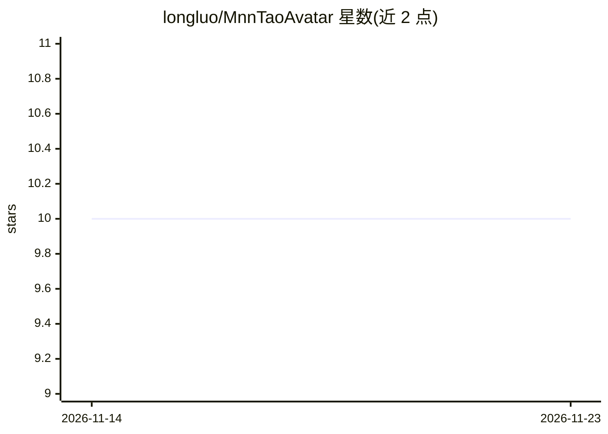

# longluo/MnnTaoAvatar

⭐ 10 · C++ · MIT · 推送 2026-07-13 · [GitHub](https://github.com/longluo/MnnTaoAvatar) · 组织维护 · 中文 README

**Android 端全本地运行的 3D 数字人多模态对话应用**

基于 TaoAvatar 论文（arXiv:2503.17032v1）的 Android 应用，将 LLM、ASR、TTS、A2BS（音频到表情混合形状）与神经渲染五类模型全部在本地设备运行，实现可对话、可听、可发声、有表情动画的 3D 数字人，100% 离线运行。因模型全部端侧执行，要求骁龙 8 Gen 3 级旗舰 SoC、8GB 以上内存与 5GB 磁盘空间。通过克隆 MNN 仓库后以 Android Studio 或 gradlew 构建部署，也提供 APK 下载版本。

## 筛选速览

| 维度 | 判定 | 备注 |
|---|---|---|
| AI 角色 | `ai-native` | 本体是模型或模型工具 |
| 许可风险 | `permissive` | MIT |
| 部署形态 | `None` |  |
| 模型依赖 | — | README 未给出锁定关系 |
| 硬件要求 | — | 无带数字的原话,不猜 |
| 安装摩擦 | `low` | 无编译、无系统依赖或容器化 |
| 成熟度 | — | 结构信号不足 |

## 能力要点

- LLM/ASR/TTS/A2BS/神经渲染五类模型全部端侧本地运行
- 100% 离线、隐私导向
- 基于 TaoAvatar 论文的音频驱动表情动画与实时神经渲染
- 提供 Releases APK 下载（当前版本 0.0.2，加入 supertonic TTS 支持）

## 适用场景

- 在旗舰 Android 手机上与本地 3D 数字人语音对话
- 无网络环境下运行多模态语音交互应用
- 研究端侧多模型（LLM+ASR+TTS+渲染）协同部署方案

## 场景标签

`语音 Agent` `多模态` · 领域:对话与助手

## 证据(README 行号)

> L8: Welcome to **MNN-TaoAvatar App**, a full-featured mobile app about the TaoAvatar paper (arXiv:2503.17032v1). This pr
> L32: Because **all AI models are executed locally on-device**, this project requires **high-performance hardware** to ru

## 星数曲线

2026-11-14 10 → 2026-11-23 10（+0）

---
*卡片 v1 · prompt 1.4 · 生成 2026-11-19 · 置信度 high · 依据 README sha `55bee4347a7e` · [字段定义](../../DATASET.md)*
