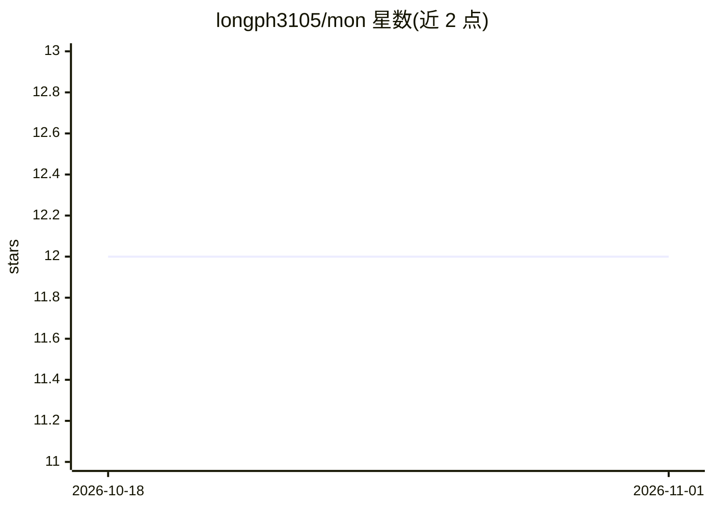

# longph3105/mon

⭐ 12 · Python · MIT · 推送 2026-09-11 · [GitHub](https://github.com/longph3105/mon) · [官网](https://phlong3105.github.io/mon/) · 个人维护

**计算机视觉研究 Monorepo：Python+PyTorch 多项目集合**

基于 Python 和 PyTorch 构建的计算机视觉研究 Monorepo，包含多个项目（projects）与跨项目共享的公共代码库（libs），代码与 PyTorch >= 2.0 兼容。安装方式为 git clone 源码后运行 scripts/bootstrap.sh 脚本。README 提供目录结构说明与 BibTeX 引用条目，未列出具体视觉任务或模型清单。

## 筛选速览

| 维度 | 判定 | 备注 |
|---|---|---|
| AI 角色 | `ai-native` | 本体是模型或模型工具 |
| 许可风险 | `permissive` | MIT |
| 部署形态 | `None` |  |
| 模型依赖 | — | README 未给出锁定关系 |
| 硬件要求 | — | 无带数字的原话,不猜 |
| 安装摩擦 | `low` | 无编译、无系统依赖或容器化 |
| 成熟度 | — | 结构信号不足 |

## 能力要点

- Monorepo 组织：多个 projects + 共享 libs
- 与 PyTorch >= 2.0 完全兼容
- bootstrap.sh 脚本化安装

## 适用场景

- 计算机视觉研究的代码基础与实验框架
- 复用共享库快速搭建视觉项目

## 场景标签

 · 领域:计算机视觉/深度学习

## 证据(README 行号)

> L3: `🐈 mon` is a research **Monorepo** for computer vision, built using Python and PyTorch.
> L20: `🐈 mon` is a **Monorepo** with multiple projects (``projects``) and shared common libs (``libs``).

## 星数曲线

2026-10-18 12 → 2026-11-01 12（+0）

---
*卡片 v1 · prompt 1.4 · 生成 2026-11-01 · 置信度 mid · 依据 README sha `edd070d66605` · [字段定义](../../DATASET.md)*
