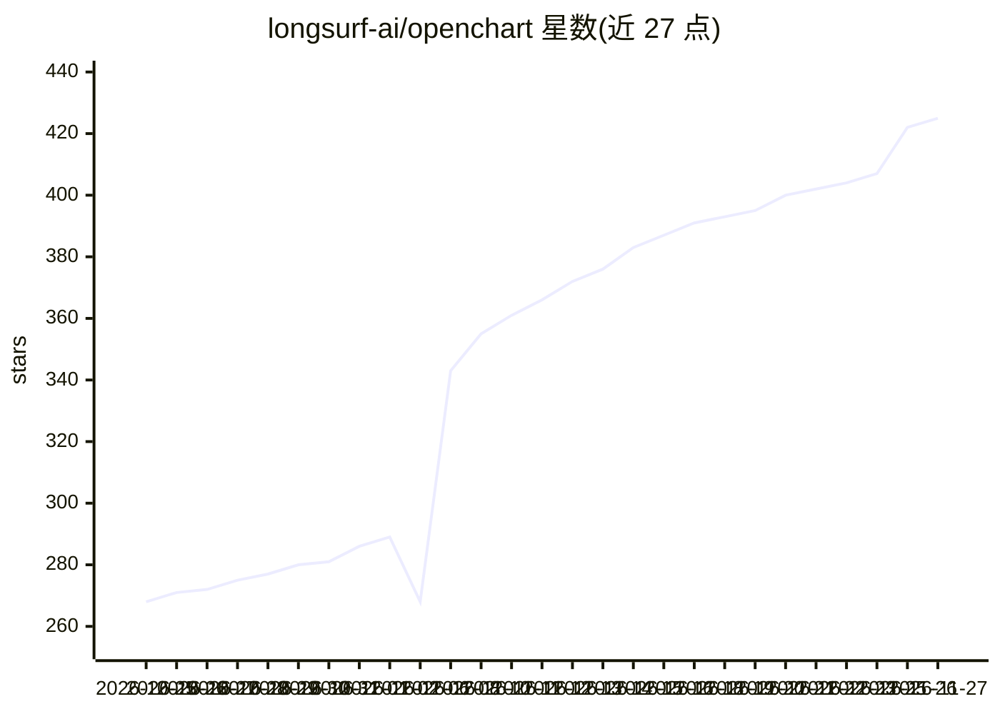

# longsurf-ai/openchart

⭐ 425 · TypeScript · MIT · 推送 2026-11-10 · [GitHub](https://github.com/longsurf-ai/openchart) · [官网](https://chart.chat) · 组织维护

**面向交易者的开源图表工作台，可接入自有 AI agent**

OpenChart 是一个开源桌面交易工作台：提供图表、指标（如布林带、Volume Profile）、4×4 多图网格、无软件套餐配额限制的价格与指标警报，并用自研 Tea 语言编写市场逻辑与监视器。AI 部分支持用户使用已有的 Claude、Codex、Gemini 账户接入 agent，用于市场研究、构建指标、设置警报、解释图表行情变动。Desktop 免费提供 macOS（Apple Silicon）安装包，可从源码运行；市场数据经 TradingView、Yahoo Finance、Binance 或本地数据集自带接入。

## 筛选速览

| 维度 | 判定 | 备注 |
|---|---|---|
| AI 角色 | `ai-enhanced` | 去掉 AI 部分产品仍成立 |
| 许可风险 | `permissive` | MIT |
| 部署形态 | `None` |  |
| 模型依赖 | locked-api |  |
| 硬件要求 | — | 无带数字的原话,不猜 |
| 安装摩擦 | `low` | 无编译、无系统依赖或容器化 |
| 成熟度 | — | 结构信号不足 |

## 能力要点

- 接入用户已有的 Claude/Codex/Gemini 账户进行市场研究与指标构建
- Tea 语言编写自定义指标与条件监视器，条件触发时可唤起 agent 调查
- 图表、指标与警报无软件套餐配额限制
- agent 研究结果以带来源链接的标注固定在图表区间上

## 适用场景

- 创建图表与警报并让 AI agent 研究价格变动原因
- 用自然语言描述关注条件，由 agent 生成 Tea 监视器
- 自备 TradingView/Binance 等数据源进行技术分析

## 场景标签

`金融量化` · 领域:学习与行业

## 证据(README 行号)

> L17: OpenChart brings AI agents into every step of your investment journey: statistical
> L53:  A real OpenChart chart gains Bollinger Bands and Volume Profile, then expands to a sixteen-chart 4-by-4 grid.
> L59:  Use your Claude, Codex, and Gemini models to research markets, build indicators, and set up alerts with the accoun

## 星数曲线

2026-10-25 268 → 2026-11-27 425（+157）

---
*卡片 v1 · prompt 1.4 · 生成 2026-11-25 · 置信度 high · 依据 README sha `075aa48553ec` · [字段定义](../../DATASET.md)*
