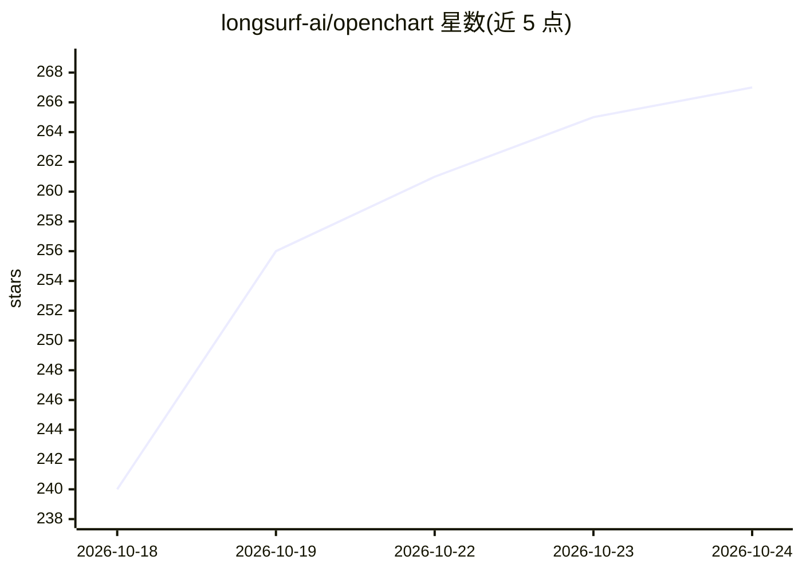

# longsurf-ai/openchart

⭐ 267 · TypeScript · NOASSERTION · 推送 2026-10-18 · [GitHub](https://github.com/longsurf-ai/openchart) · [官网](https://chart.chat) · 组织维护

**开源交易图表工作台，接入自有 AI agent 做市场研究**

面向个人投资者的开源交易工作区：提供无软件配额限制的图表（指标、Volume Profile、4×4 网格）、价格与指标警报，以及用 Tea 语言（团队自研、受 Pine Script 启发的市场分析语言）编写自定义指标与条件。AI 部分：用户接入自己的 Claude、Codex、Gemini 模型账户，由 agent 研究行情、构建指标、在条件触发时调研异动并附来源标注。提供 macOS (Apple Silicon) 桌面安装包，也可用 Node.js 24/Bun/Just 从源码运行；桌面端免费，AI 用量按用户 provider 计费，云行情数据单独计价。

## 筛选速览

| 维度 | 判定 | 备注 |
|---|---|---|
| AI 角色 | `ai-enhanced` | 去掉 AI 部分产品仍成立 |
| 许可风险 | `none` | NOASSERTION |
| 部署形态 | `None` |  |
| 模型依赖 | — | README 未给出锁定关系 |
| 硬件要求 | — | 无带数字的原话,不猜 |
| 安装摩擦 | `low` | 无编译、无系统依赖或容器化 |
| 成熟度 | — | 结构信号不足 |

## 能力要点

- 图表、指标与警报无软件套餐配额限制
- 使用用户自有 Claude / Codex / Gemini 模型账户
- Tea 语言编写随数据流计算的自定义指标与监控条件
- 图上划线/选区触发 agent 调研并固定带来源的标注

## 适用场景

- 看盘时让 AI agent 研究某个价格异动的原因
- 用自然语言描述监控条件，自动生成 Tea 监控与警报
- 自托管交易图表工作台并在本地运行

## 场景标签

`金融量化` · 领域:学习与行业

## 证据(README 行号)

> L17: OpenChart brings AI agents into every step of your investment journey: statistical
> L53:  Charts without software quotas
> L57:  Use your own agents

## 星数曲线

2026-10-18 240 → 2026-10-24 267（+27）

---
*卡片 v1 · prompt 1.4 · 生成 2026-10-22 · 置信度 high · 依据 README sha `be5dd3e5d8b3` · [字段定义](../../DATASET.md)*
