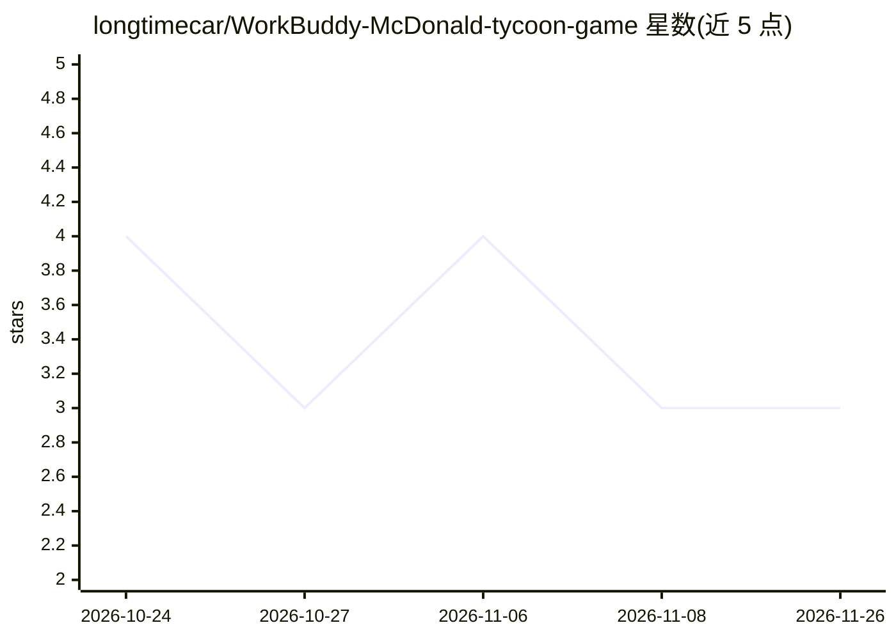

# longtimecar/WorkBuddy-McDonald-tycoon-game

⭐ 3 · Python · MIT · 推送 2026-10-18 · [GitHub](https://github.com/longtimecar/WorkBuddy-McDonald-tycoon-game) · [官网](https://longtimecar.github.io/WorkBuddy-McDonald-tycoon-game/) · 个人维护 · 中文 README

**用麦当劳官方 MCP 真实菜单驱动的餐厅经营模拟游戏**

餐厅经营模拟游戏：玩家每天做定价、备货、营销三个决定，顾客 NPC 根据菜单数据做出点单与吐槽反应（98 条离线吐槽语料，无需 API Key 可玩；LLM 顾客增强中）。菜单与价格数据来自麦当劳中国官方 MCP，无 Token 时使用内置演示快照。游戏引擎基于 Python 3.11+ 标准库，无第三方依赖。提供 CLI、Web（在线试玩或本地打开 index.html）、WorkBuddy Skill 三种形态，每局结束生成省钱攻略与每日战报图，支持 7 天挑战模式与评级。

## 筛选速览

| 维度 | 判定 | 备注 |
|---|---|---|
| AI 角色 | `ai-enhanced` | 去掉 AI 部分产品仍成立 |
| 许可风险 | `permissive` | MIT |
| 部署形态 | `None` |  |
| 模型依赖 | — | README 未给出锁定关系 |
| 硬件要求 | — | 无带数字的原话,不猜 |
| 安装摩擦 | `low` | 无编译、无系统依赖或容器化 |
| 成熟度 | — | 结构信号不足 |

## 能力要点

- 菜单与价格来自麦当劳中国官方 MCP，支持 live/mock 双模式
- 离线吐槽语料 98 条，无 API Key 可完整游玩
- 三种形态：CLI、Web 在线试玩、WorkBuddy Skill
- 每局生成个性化省钱攻略与每日经营战报图

## 适用场景

- 想 3 分钟体验一个模拟游戏的普通玩家
- 想了解麦当劳官方 MCP 用法的开发者
- 把顾客吐槽截图和省钱攻略当社交素材

## 场景标签

 · 领域:游戏/模拟经营

## 证据(README 行号)

> L19: 《麦当劳大亨》是一个**餐厅经营模拟游戏**：你接手一家麦当劳，每天做三个决定——**定价、备货、营销**，然后看着真实菜单数据驱动的顾客们用脚投票。
> L22: - 🤬 顾客会点单、会吐槽，会因为你把薯条定价 99 元喷上差评热搜（98 条离线吐槽语料，无需 API Key 照样玩；LLM 顾客增强中）；
> L102: No build, no dependencies, Python 3.11+ standard library only. An offline mode keeps it fully playable without any

## 星数曲线

2026-10-24 4 → 2026-11-26 3（-1）

---
*卡片 v1 · prompt 1.4 · 生成 2026-11-21 · 置信度 high · 依据 README sha `33253846b4c7` · [字段定义](../../DATASET.md)*
