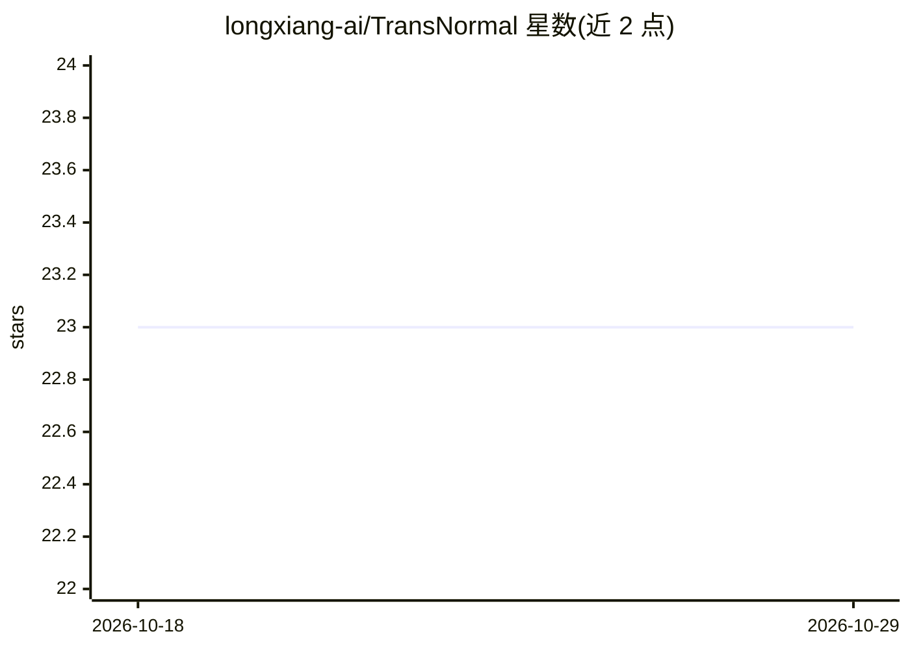

# longxiang-ai/TransNormal

⭐ 23 · Python · NOASSERTION · 推送 2026-09-09 · [GitHub](https://github.com/longxiang-ai/TransNormal) · [官网](https://longxiang-ai.github.io/TransNormal/) · 组织维护

**面向透明物体的单步扩散法向估计模型（ICML 2026 论文官方实现）**

ICML 2026 论文 TransNormal 的官方实现：基于单步扩散模型，从单张 RGB 图像预测透明物体表面法向，机制为将稠密 DINOv3 视觉语义注入扩散几何先验并施以小波正则化。提供 Python API、CLI（单图/批量）、Gradio Web UI，附带预训练权重、训练与六个基准评测流程，以及含 4,000 视角的 TransNormal-Synthetic 合成数据集。依赖 DINOv3 ViT-H+/16 权重（需向 Meta AI 申请访问），项目采用 CC BY-NC 4.0 非商业许可。

## 筛选速览

| 维度 | 判定 | 备注 |
|---|---|---|
| AI 角色 | `ai-native` | 本体是模型或模型工具 |
| 许可风险 | `none` | NOASSERTION |
| 部署形态 | `library` | 以包/库形式分发 |
| 模型依赖 | — | README 未给出锁定关系 |
| 硬件要求 | — | 无带数字的原话,不猜 |
| 安装摩擦 | `medium` | 含编译或系统依赖之一 |
| 成熟度 | — | 结构信号不足 |

## 能力要点

- RGB 单图输入的透明物体表面法向估计（单步扩散）
- 稠密 DINOv3 语义注入扩散先验 + 小波正则化
- 提供训练、推理、评测全流程与预训练权重
- 附带 TransNormal-Synthetic 数据集（4,000 视角，WebDataset 格式）

## 适用场景

- 对透明物体照片生成相机坐标系下的表面法向图
- 在 ClearGrasp/ClearPose 等基准上复现或评测法向估计结果
- 用合成数据集训练或微调透明物体几何估计模型

## 场景标签

`图像视频处理` · 领域:感知与多模态

## 证据(README 行号)

> L19: - RGB-only surface normal estimation for transparent objects.
> L20: - Dense DINOv3 visual semantics injected into a diffusion geometry prior.
> L21: - State-of-the-art results on ClearGrasp and ClearPose.

## 星数曲线

2026-10-18 23 → 2026-10-29 23（+0）

---
*卡片 v1 · prompt 1.4 · 生成 2026-10-27 · 置信度 mid · 依据 README sha `6e569456399e` · [字段定义](../../DATASET.md)*
