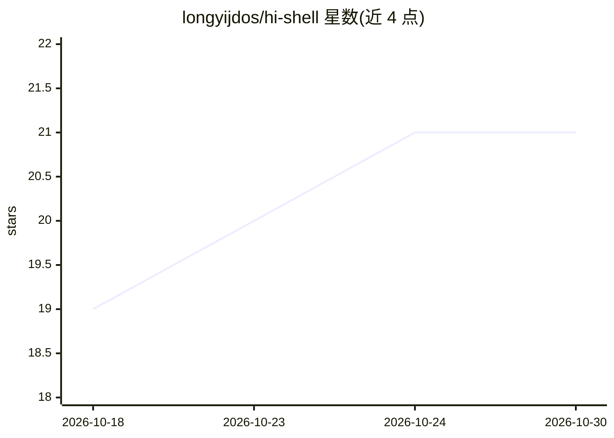

# longyijdos/hi-shell

⭐ 21 · Go · MIT · 推送 2026-09-26 · [GitHub](https://github.com/longyijdos/hi-shell) · 个人维护

**zsh 插件：自然语言生成 shell 命令，以 ghost text 呈现**

用 Go 编写的二进制程序，接入 zsh 的 ZLE widgets：在提示符输入 hi 加自然语言描述，调用所配置的 LLM 生成命令建议，以 ghost text 形式显示，按 Tab 接受到可编辑命令行，按 Enter 执行。支持 hi? 询问建议详情、hi: 修改建议。内置本地风险评分，将建议分为 safe/warn/blocked，明确灾难性命令（如 rm -rf /）默认阻断；生成的命令不会自动执行。支持 OpenAI（默认）、DeepSeek、Claude 三种 provider，API key 仅存于环境变量。

## 筛选速览

| 维度 | 判定 | 备注 |
|---|---|---|
| AI 角色 | `ai-native` | 本体是模型或模型工具 |
| 许可风险 | `permissive` | MIT |
| 部署形态 | `None` |  |
| 模型依赖 | locked-api |  |
| 硬件要求 | — | 无带数字的原话,不猜 |
| 安装摩擦 | `low` | 无编译、无系统依赖或容器化 |
| 成熟度 | — | 结构信号不足 |

## 能力要点

- 自然语言生成 shell 命令，ghost text 编辑式建议（Tab 接受/Enter 执行）
- hi? 追问与 hi: 修改已有建议
- 本地风险评分 safe/warn/blocked，灾难性命令默认阻断
- 支持 OpenAI / DeepSeek / Claude，密钥只存环境变量

## 适用场景

- 忘记命令语法时在提示符内直接用自然语言要命令
- 追问或修正 AI 给出的命令建议
- 担心危险命令时依靠风险评分拦截

## 场景标签

`代码生成` · 领域:编码与开发

## 证据(README 行号)

> L11: Type `hi` and describe what you need. It asks your configured LLM for a command and shows the suggestion as ghost t
> L9: `hi-shell` is for the moment you know what you want to do but can't recall the command. It's a small Go binary wired

## 星数曲线

2026-10-18 19 → 2026-10-30 21（+2）

---
*卡片 v1 · prompt 1.4 · 生成 2026-10-28 · 置信度 high · 依据 README sha `710a0ae7d4e7` · [字段定义](../../DATASET.md)*
