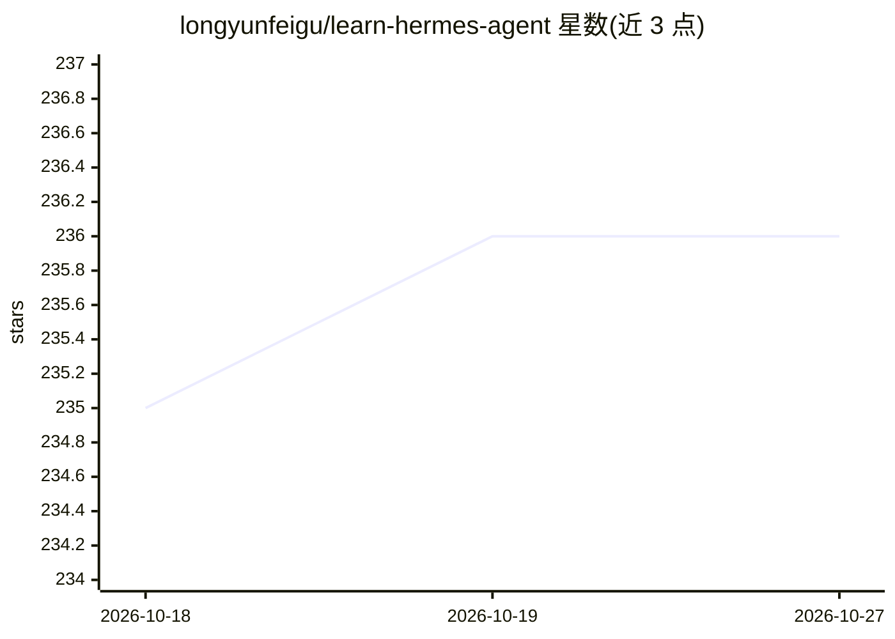

# longyunfeigu/learn-hermes-agent

⭐ 236 · Python · MIT · 推送 2026-05-14 · [GitHub](https://github.com/longyunfeigu/learn-hermes-agent) · 个人维护 · 中文 README

**从零构建自主 AI agent 的 27 章实践教程**

面向掌握基础 Python 的开发者，以代码优先方式教学如何从零构建生产级自主 AI agent。27 章覆盖对话循环、自注册工具系统、SQLite+FTS5 会话持久化、记忆与技能系统、上下文压缩、权限审批、MCP、多平台网关（Telegram/Discord/Slack/微信）、终端后端（Docker/SSH/Modal/Daytona）及基于轨迹/RL 的自进化。每章配 agents/ 下可运行参考实现与中英文讲解。机制教学为主线，刻意不含打包、计费、遥测等生产细节。

## 筛选速览

| 维度 | 判定 | 备注 |
|---|---|---|
| AI 角色 | `ai-knowledge` | 知识聚合/清单类 |
| 许可风险 | `permissive` | MIT |
| 部署形态 | `library` | 以包/库形式分发 |
| 模型依赖 | — | README 未给出锁定关系 |
| 硬件要求 | — | 无带数字的原话,不猜 |
| 安装摩擦 | `low` | 无编译、无系统依赖或容器化 |
| 成熟度 | — | 结构信号不足 |

## 能力要点

- 每章配 agents/sNN_*.py 可运行参考实现与中英文文档
- 覆盖工具系统、会话持久化、记忆/技能、上下文压缩等核心机制
- 多平台网关章节涉及 Telegram/Discord/Slack/微信适配器
- s21-s27 讲授技能创建、轨迹/RL、评测与自进化优化循环

## 适用场景

- 系统学习从零搭建自主 AI agent 的完整机制
- 跟随五阶段路线亲手重建最小可用的 agent 核心
- 参考多平台消息网关与终端后端的实现模式

## 场景标签

`教程课程` · 领域:学习与行业

## 证据(README 行号)

> L5: **Build a production-grade autonomous AI agent from scratch in Python.** A 27-chapter, code-first tutorial covering 
> L7: Every chapter ships a runnable reference implementation under `agents/sNN_*.py`, paired with a prose explanation und

## 星数曲线

2026-10-18 235 → 2026-10-27 236（+1）

---
*卡片 v1 · prompt 1.4 · 生成 2026-10-22 · 置信度 mid · 依据 README sha `09ad9c502661` · [字段定义](../../DATASET.md)*
