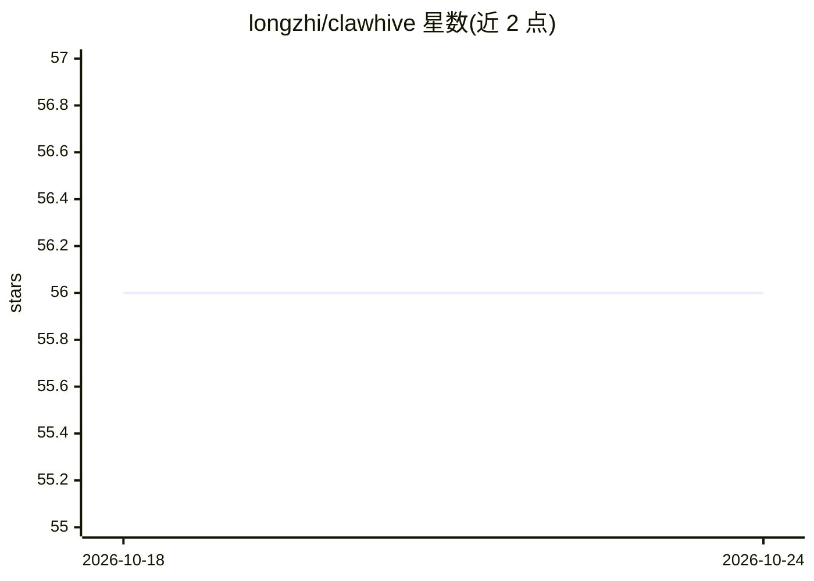

# longzhi/clawhive

⭐ 56 · Rust · MIT · 推送 2026-05-13 · [GitHub](https://github.com/longzhi/clawhive) · 个人维护 · 中文 README

**Rust 单二进制的多渠道 AI Agent 部署平台**

用 Rust 编写的开源 AI Agent 平台，单个约 14 MB 二进制文件、无运行时依赖，即可在 Telegram、Discord、Slack、WhatsApp、iMessage、飞书、钉钉、企业微信等渠道部署多个 AI agent。面向想自托管聊天机器人的开发者与个人用户。核心机制：ReAct 推理循环与子 agent 派生、三层记忆系统（会话 JSONL→每日文件→MEMORY.md）配 sqlite-vec+FTS5 混合检索、SKILL.md 声明式权限与双层安全模型（硬基线+来源信任）、LLM 提供商抽象（Anthropic/OpenAI/Gemini/Bedrock/DeepSeek/Groq/Ollama 等）。支持 Web/CLI 向导配置，提供 GitHub Releases 下载与 install.sh 安装，开发者可从 Rust 1.92+ 源码构建。项目处于活跃开发中。

## 筛选速览

| 维度 | 判定 | 备注 |
|---|---|---|
| AI 角色 | `ai-ecosystem` | LLM/agent 周边工具 |
| 许可风险 | `permissive` | MIT |
| 部署形态 | `None` |  |
| 模型依赖 | local-ok | 支持本地模型 |
| 硬件要求 | — | 无带数字的原话,不猜 |
| 安装摩擦 | `low` | 无编译、无系统依赖或容器化 |
| 成熟度 | `idea` | |

## 能力要点

- 单二进制（~14 MB）零运行时依赖，可在树莓派/VPS 运行
- 双层安全模型：不可绕过硬基线 + SKILL.md 声明式权限
- 三层记忆系统与 sqlite-vec+FTS5 混合检索、LLM 驱动的记忆固化
- 多渠道适配器（Telegram/Discord/Slack/WhatsApp/飞书/钉钉/企微等）

## 适用场景

- 在 Telegram、Discord、飞书等聊天渠道自托管 AI agent
- 轻量设备（树莓派）上低资源运行多 agent 服务
- 对技能权限与执行边界有安全要求的 agent 部署

## 场景标签

`Agent 框架` `多智能体` `聊天机器人` `Agent 记忆` · 领域:Agent 开发

## 证据(README 行号)

> L10: An open-source, Rust-native alternative to OpenClaw — deploy your own AI agents across Telegram, Discord, Feishu/La
> L95: - LLM provider abstraction with retry + exponential backoff (Anthropic, OpenAI, Gemini, Amazon Bedrock, DeepSeek, G
> L87: - Multi-agent orchestration with per-agent personas, model routing, and memory policy controls

## 星数曲线

2026-10-18 56 → 2026-10-24 56（+0）

---
*卡片 v1 · prompt 1.4 · 生成 2026-10-24 · 置信度 high · 依据 README sha `93c76f075369` · [字段定义](../../DATASET.md)*
