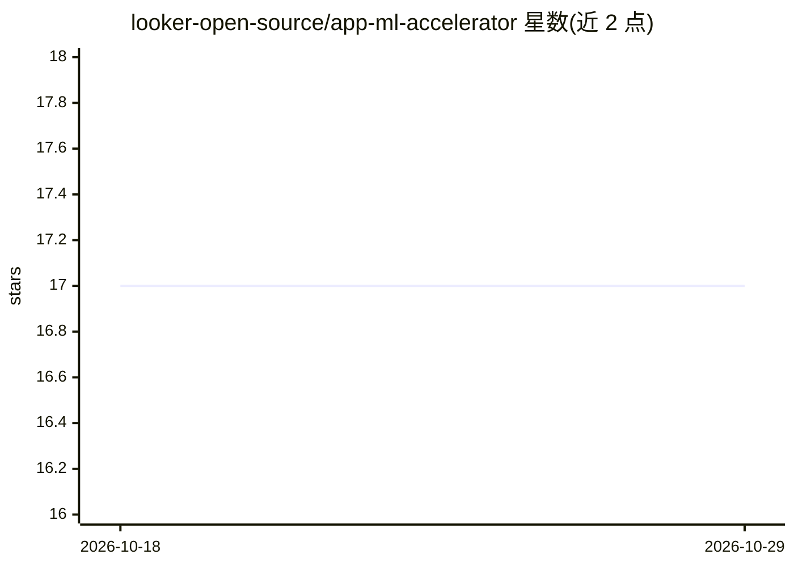

# looker-open-source/app-ml-accelerator

⭐ 17 · LookML · NOASSERTION · 推送 2026-06-04 · [GitHub](https://github.com/looker-open-source/app-ml-accelerator) · [官网](https://youtu.be/bvP5syhh2AI) · 组织维护

**让业务用户在 Looker 中无代码创建 BigQuery/Vertex AI 机器学习模型的应用**

Looker 扩展应用，面向业务分析师，通过无代码界面引导用户逐步创建机器学习模型，访问 BigQuery ML 与 Vertex AI 能力。安装需 Looker 管理员配置：选择单个 BigQuery 连接、为服务账号授予 BigQuery Data Editor/Job User 与 Vertex AI User 角色、创建模型数据集、配置三个用户属性并建立专用 Looker 角色管理访问权限。可从 Looker Marketplace 安装或手动 fork 仓库部署到名为 marketplace_bqml_ext 的 LookML 项目。2.2 版后可选启用 AI 生成的模型评估摘要，需在 BigQuery 中创建 Vertex 远程文本生成模型（建议 gemini-2.0-flash）。项目声明非 Google 官方支持产品。

## 筛选速览

| 维度 | 判定 | 备注 |
|---|---|---|
| AI 角色 | `ai-native` | 本体是模型或模型工具 |
| 许可风险 | `none` | NOASSERTION |
| 部署形态 | `None` |  |
| 模型依赖 | — | README 未给出锁定关系 |
| 硬件要求 | — | 无带数字的原话,不猜 |
| 安装摩擦 | `low` | 无编译、无系统依赖或容器化 |
| 成熟度 | — | 结构信号不足 |

## 能力要点

- 无代码界面引导业务用户创建机器学习模型
- 访问 BigQuery ML 与 Vertex AI 能力
- 支持 AI 生成的模型评估摘要（可选，需 Vertex 远程模型）
- 可从 Looker Marketplace 一键安装或手动部署

## 适用场景

- 业务分析师在 Looker 内学习并使用预测分析
- 无 SQL 基础的用户创建 BigQuery ML 模型
- 通过 AI 摘要理解模型评估结果

## 场景标签

`数据分析` · 领域:效率与自动化

## 证据(README 行号)

> L5: The ML Accelerator is a purpose-built Looker application designed to give business users access to BigQuery and Vert
> L75: After release 2.2, the application can use text generating AI to summarize the model evaluation to more clearly com

## 星数曲线

2026-10-18 17 → 2026-10-29 17（+0）

---
*卡片 v1 · prompt 1.4 · 生成 2026-10-29 · 置信度 high · 依据 README sha `6c838d4752ab` · [字段定义](../../DATASET.md)*
