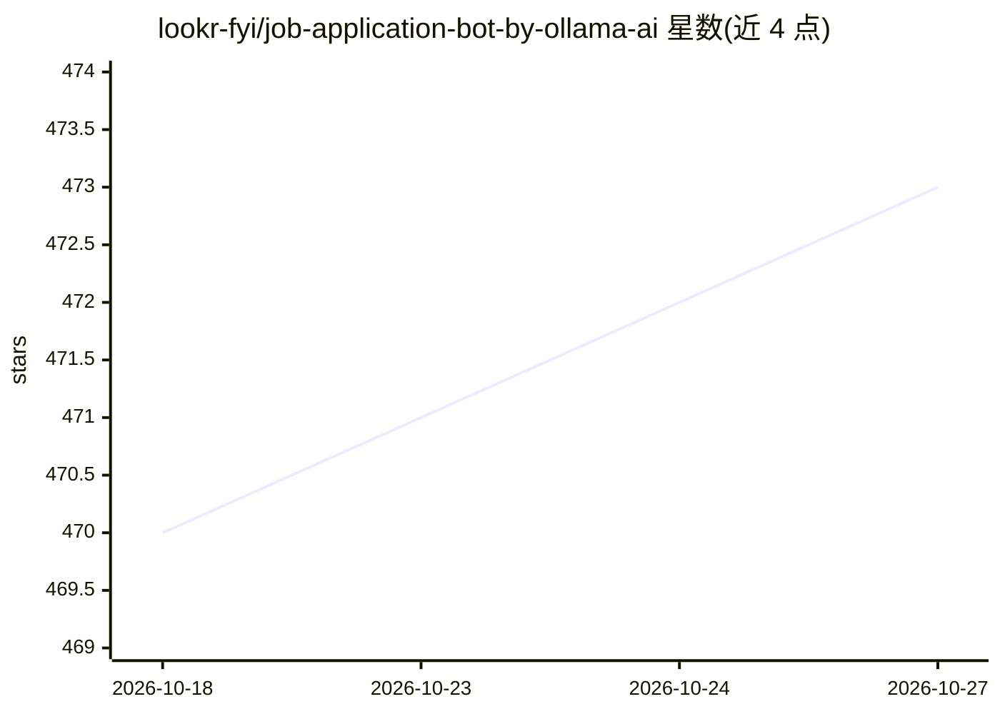

# lookr-fyi/job-application-bot-by-ollama-ai

⭐ 473 · 推送 2026-03-03 · [GitHub](https://github.com/lookr-fyi/job-application-bot-by-ollama-ai) · [官网](https://jobhuntr.fyi) · 组织维护

**面向求职者的自动投递 AI agent 桌面应用**

JobHuntr 是一款求职自动化 AI agent 桌面应用（macOS/Windows 下载安装），核心功能包括：按简历与自定义过滤条件自动搜索与投递职位、为每次申请生成 ATS 优化简历与求职信、自动回答申请问题、24/7 后台自动投递（Infinite Hunt）、职位申请追踪、公司黑名单，以及投递后向招聘方发送个性化消息。支持从任意 URL 启动求职流程，AI 决策过程可逐步查看。采用云 AI 模型，提供 Slack 社区与付费方案（Starter $9.99 起）。

## 筛选速览

| 维度 | 判定 | 备注 |
|---|---|---|
| AI 角色 | `ai-native` | 本体是模型或模型工具 |
| 许可风险 | `none` | — |
| 部署形态 | `None` |  |
| 模型依赖 | — | README 未给出锁定关系 |
| 硬件要求 | — | 无带数字的原话,不猜 |
| 安装摩擦 | `low` | 无编译、无系统依赖或容器化 |
| 成熟度 | — | 结构信号不足 |

## 能力要点

- 自动投递职位并生成 ATS 优化简历与求职信
- Infinite Hunt 后台持续搜索新职位并自动调整配置
- 任意公司官网提交简历的通用申请能力（v3.2.0）
- 职位申请追踪与 AI 决策步骤展示

## 适用场景

- 让 AI 全天候自动搜索并投递匹配的职位
- 为每个职位自动生成定制化 ATS 简历
- 集中追踪所有求职申请的状态

## 场景标签

`浏览器自动化` `AI 写作` · 领域:效率与自动化

## 证据(README 行号)

> L45: - Introduced an autonomous agent that enables you to start job searches from any URL, automatically generates custo
> L67: Stepping into a new career can be extremely exhausting, but it doesn't have to be. JobHuntr is built to be a reliab
> L81: |Generate ATS Resume|Generate ATS-optimized resume for each job application.|

## 星数曲线

2026-10-18 470 → 2026-10-27 473（+3）

---
*卡片 v1 · prompt 1.4 · 生成 2026-10-21 · 置信度 mid · 依据 README sha `a154a4063b63` · [字段定义](../../DATASET.md)*
