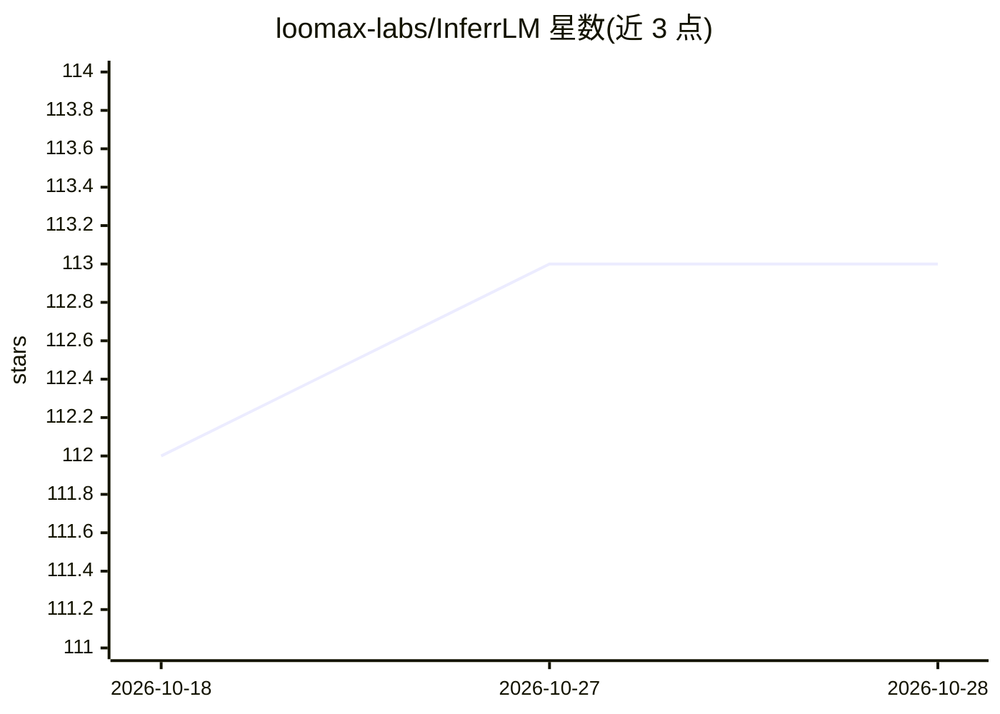

# loomax-labs/InferrLM

⭐ 113 · TypeScript · AGPL-3.0 · 推送 2026-09-26 · [GitHub](https://github.com/loomax-labs/InferrLM) · 组织维护 · 中文 README

**手机上本地运行 LLM 并充当局域网服务器的 AI 应用**

面向 Android/iOS 用户的移动应用（React Native/Expo 构建）：通过 llama.cpp 在设备上运行 GGUF 模型，Apple Silicon 设备支持 MLX 推理与 Apple Foundation Model；支持接入 OpenAI/Gemini/Anthropic 云端模型及 OpenAI 兼容自定义端点。功能包括多模态视觉、本地 OCR 文档处理与 RAG 对话；内置 HTTP 服务器暴露 OpenAI 格式 REST API，供局域网内其他设备访问。AGPL-3.0 许可，应用商店版本落后于代码库，源码构建需 Node.js/Expo/Android Studio/Xcode。

## 筛选速览

| 维度 | 判定 | 备注 |
|---|---|---|
| AI 角色 | `ai-native` | 本体是模型或模型工具 |
| 许可风险 | `viral` | AGPL-3.0 |
| 部署形态 | `library` | 以包/库形式分发 |
| 模型依赖 | local-ok | 支持本地模型 |
| 硬件要求 | — | 无带数字的原话,不猜 |
| 安装摩擦 | `low` | 无编译、无系统依赖或容器化 |
| 成熟度 | — | 结构信号不足 |

## 能力要点

- llama.cpp 本地推理 GGUF 模型，Apple Silicon 另支持 MLX
- 本地 OCR 文档提取与 RAG 文档问答
- 内置 HTTP 服务器，局域网内暴露 OpenAI 格式 REST API
- HuggingFace 模型下载管理与多模态视觉支持

## 适用场景

- 在手机上离线运行 LLM 进行对话与文档问答
- 把手机作为局域网内的本地推理服务器供其他设备调用
- 在同一应用内切换本地模型与云端 API 模型

## 场景标签

`文档问答` `多模态` `OCR` `推理引擎` · 领域:知识与检索

## 证据(README 行号)

> L12: InferrLM is a mobile application that brings LLMs & SLMs directly to your Android & iOS device and lets your device
> L29: - Core local inference through llama.cpp with support for GGUF models on both Android and iOS.

## 星数曲线

2026-10-18 112 → 2026-10-28 113（+1）

---
*卡片 v1 · prompt 1.4 · 生成 2026-10-23 · 置信度 mid · 依据 README sha `867a9ba4ac82` · [字段定义](../../DATASET.md)*
