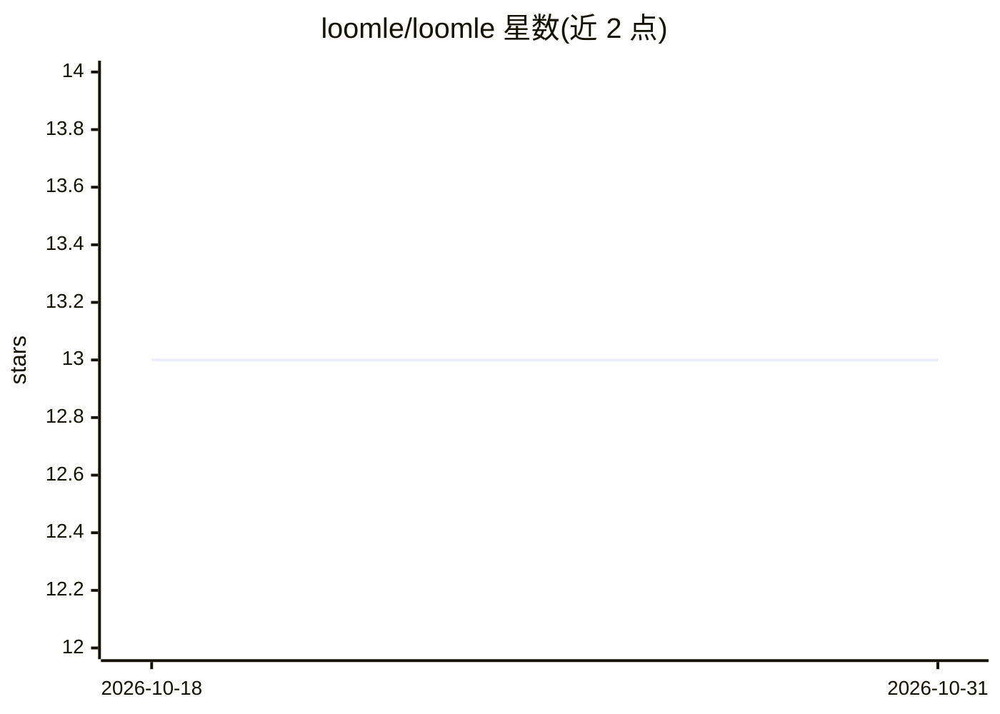

# loomle/loomle

⭐ 13 · C++ · MIT · 推送 2026-10-12 · [GitHub](https://github.com/loomle/loomle) · [官网](https://loomle.ai) · 组织维护

**让 AI agent 读写 Unreal 编辑器对象的 MCP 工具链（SAL）**

面向 Unreal Engine 5.7/5.8 的 agent-native 集成：通过 SAL（Structured Agent Language）把 Blueprint 图、Widget 树、Class 反射、资产等非文本 UE 状态转为紧凑有序文本，供人与 agent 读取、讨论和修补。独立 Client 暴露 8 个 MCP 工具（status/project/sal_query/sal_patch/sal_schema/agent_skill/editor/python），配 LoomleBridge 编辑器插件运行。以 GitHub Releases 二进制插件包与 Fab 市场分发，版本 0.7，MIT 许可。

## 筛选速览

| 维度 | 判定 | 备注 |
|---|---|---|
| AI 角色 | `ai-ecosystem` | LLM/agent 周边工具 |
| 许可风险 | `permissive` | MIT |
| 部署形态 | `desktop` | 安装包/桌面程序 |
| 模型依赖 | — | README 未给出锁定关系 |
| 硬件要求 | — | 无带数字的原话,不猜 |
| 安装摩擦 | `low` | 无编译、无系统依赖或容器化 |
| 成熟度 | — | 结构信号不足 |

## 能力要点

- 8 个 MCP 工具覆盖查询、修补、schema 发现与编辑器控制
- SAL 将 Blueprint/Widget/Class/Asset 等转为紧凑可修补文本
- sal_patch 支持先经真实解析/校验路径的 dry run 再应用变更
- 自包含 Client 可执行文件，无需 Python/Node.js 等依赖

## 适用场景

- 让 Claude/Codex 等 MCP host 中的 agent 读写 Blueprint 与 Widget
- 用文本查询与修补替代手动编辑复杂 UE 编辑器对象
- 在 agent 工作流中检查编译诊断与对象健康状态

## 场景标签

 · 领域:游戏引擎工具/agent 基础设施

## 证据(README 行号)

> L3: Loomle is an agent-native Unreal Engine integration for reading and changing
> L32: The standalone Client exposes eight MCP tools:
> L116: Enable `LoomleBridge`, restart Unreal Editor, and configure an MCP server named

## 星数曲线

2026-10-18 13 → 2026-10-31 13（+0）

---
*卡片 v1 · prompt 1.4 · 生成 2026-10-18 · 置信度 mid · 依据 README sha `91833629fe69` · [字段定义](../../DATASET.md)*
