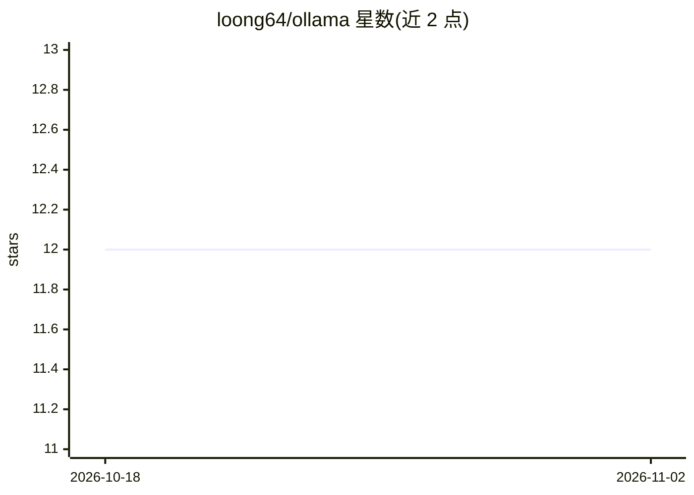

# loong64/ollama

⭐ 12 · Dockerfile · MIT · 推送 2026-10-30 · [GitHub](https://github.com/loong64/ollama) · [官网](https://github.com/ollama/ollama) · 组织维护

**本地大模型运行时：下载、运行与管理 LLM 及其 API**

Ollama 是在 macOS、Windows、Linux 与 Docker 上本地运行大语言模型的工具：通过 ollama run 命令从 ollama.com/library 拉取并运行 Llama 3、DeepSeek-R1、Phi-4、Gemma 2、Mistral 等模型；支持通过 Modelfile 导入 GGUF 模型并自定义参数与提示词。提供 CLI（create/pull/rm/cp/ps/stop 等命令）与 localhost:11434 上的 REST API（generate/chat 端点），另发布 ollama-python 与 ollama-js 库；README 列出大量社区 Web/桌面/终端集成。运行 7B 模型需至少 8GB 内存。

## 筛选速览

| 维度 | 判定 | 备注 |
|---|---|---|
| AI 角色 | `ai-ecosystem` | LLM/agent 周边工具 |
| 许可风险 | `permissive` | MIT |
| 部署形态 | `library` | 以包/库形式分发 |
| 模型依赖 | local-ok | 支持本地模型 |
| 硬件要求 | — | 无带数字的原话,不猜 |
| 安装摩擦 | `low` | 无编译、无系统依赖或容器化 |
| 成熟度 | — | 结构信号不足 |

## 能力要点

- 一条命令拉取并运行本地 LLM（ollama run）
- 通过 Modelfile 导入 GGUF 模型并自定义参数与系统提示词
- 提供 REST API（generate/chat）与 ollama-python、ollama-js 客户端库
- 官方 Docker 镜像与 macOS/Windows 安装包

## 适用场景

- 在本机命令行直接对话或调用开源 LLM
- 通过 REST API 为本地应用提供模型推理后端
- 导入自有的 GGUF 模型文件并定制提示词后运行

## 场景标签

`推理引擎` · 领域:训练与推理

## 证据(README 行号)

> L7: Get up and running with large language models.
> L235: Ollama has a REST API for running and managing models.

## 星数曲线

2026-10-18 12 → 2026-11-02 12（+0）

---
*卡片 v1 · prompt 1.4 · 生成 2026-11-01 · 置信度 high · 依据 README sha `9178d2a04650` · [字段定义](../../DATASET.md)*
