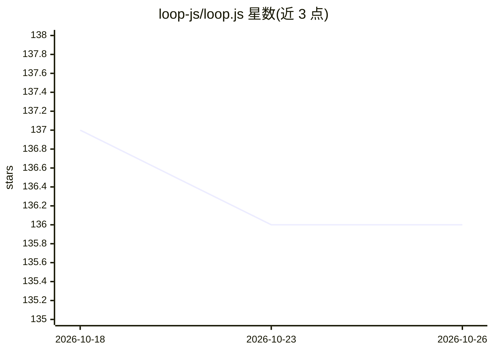

# loop-js/loop.js

⭐ 136 · TypeScript · Apache-2.0 · 推送 2026-08-30 · [GitHub](https://github.com/loop-js/loop.js) · [官网](https://loop-js.mintlify.site/) · 组织维护

**面向开发者的循环工程框架：目标驱动多轮 agent 运行直至独立验证通过**

loop.js 是一个 TypeScript/Node.js 框架，实现所谓 loop engineering：用户声明目标与“完成”标准，引擎逐轮驱动 agent（每轮全新上下文、从磁盘读回记忆），由独立的只读 Verify agent 判定是否达标才算收敛。提供 usd/rounds/timeout 预算守卫、磁盘状态与崩溃恢复、`loop cron` 可安装到 crontab/launchd/Task Scheduler 或部署到 Modal 云端。基于 Claude Agent SDK 运行（需 ANTHROPIC_API_KEY），通过 npm 安装，提供 CLI 与可嵌入的类型化库接口。当前 v0.2 beta，Pre-1.0 API 可能变动。

## 筛选速览

| 维度 | 判定 | 备注 |
|---|---|---|
| AI 角色 | `ai-ecosystem` | LLM/agent 周边工具 |
| 许可风险 | `permissive` | Apache-2.0 |
| 部署形态 | `library` | 以包/库形式分发 |
| 模型依赖 | locked-api |  |
| 硬件要求 | — | 无带数字的原话,不猜 |
| 安装摩擦 | `low` | 无编译、无系统依赖或容器化 |
| 成熟度 | `idea` | |

## 能力要点

- 独立 Verify agent（默认只读）裁决每轮，仅其判定能使 Loop 收敛
- 每轮全新上下文 + 磁盘记忆回读；usd/rounds/timeout 守卫默认收紧（$1/3轮/5分钟）
- `loop cron` 安装到真实系统调度器或 Modal 云端，Lock 保证重叠触发安全
- 提供 CLI 与可嵌入的异步迭代事件流库接口

## 适用场景

- 让 agent 反复迭代直到通过测试真正完成构建任务
- 按日程定时运行目标并自动复检（如每日简报、策略审计、维护性杂务）
- 把 agent 循环作为类型化库嵌入自己的产品

## 场景标签

`Agent 框架` · 领域:Agent 开发

## 证据(README 行号)

> L5: You state a goal and what "done" means. The engine runs an agent at it, Round after Round —
> L33: |The agent says "done" when it isn't|A separate **Verify** agent — own session, own (cheaper, if you like) model, *
> L230: (`run` / `status` / `cron` with local and Modal backends), and the Claude Agent SDK

## 星数曲线

2026-10-18 137 → 2026-10-26 136（-1）

---
*卡片 v1 · prompt 1.4 · 生成 2026-10-23 · 置信度 high · 依据 README sha `9d981a43d598` · [字段定义](../../DATASET.md)*
