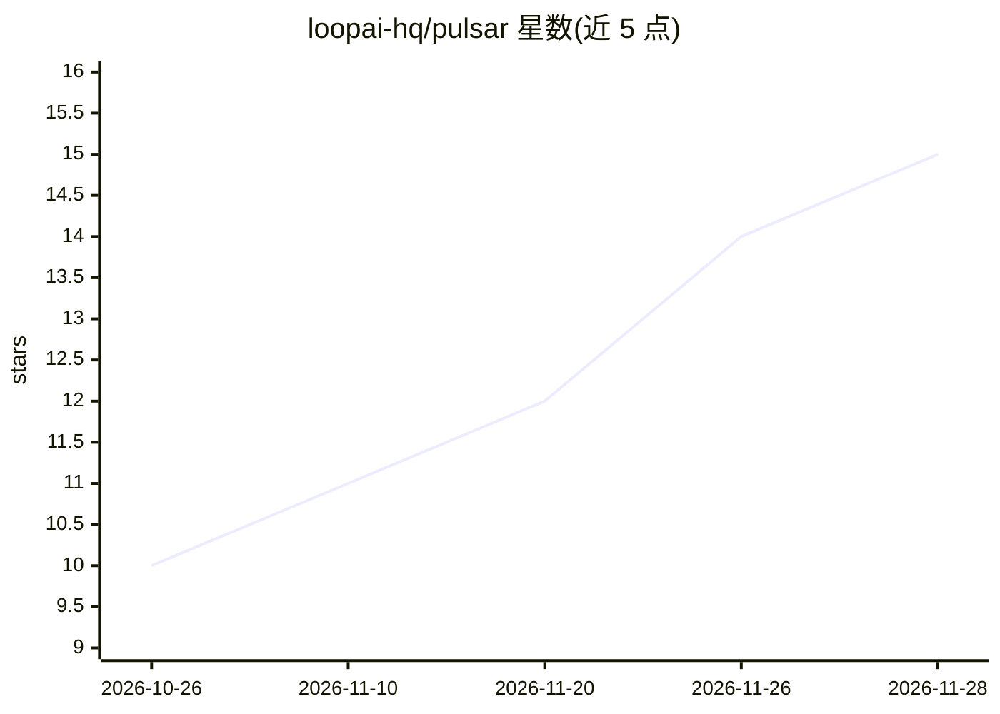

# loopai-hq/pulsar

⭐ 15 · C++ · Apache-2.0 · 推送 2026-11-24 · [GitHub](https://github.com/loopai-hq/pulsar) · 组织维护

**在 Apple Silicon Mac 上运行 Qwen 模型的本地推理引擎**

基于 Inco AI Splash 的 fork，提供更快的 GPU kernel 与推测解码草稿机制（从提示词取猜测、更轻的草稿模型），面向 Qwen3.8-27B 与 Qwen3.6-35B-A3B 模型。以 macOS arm64 压缩包发布，启动本地服务后暴露 OpenAI 与 Anthropic 兼容 API，附带一键连接 Claude Code/OpenCode/Codex 等 coding agent 的命令及 agent 技能文件。要求 Apple silicon M3 及以上、24 GB 内存、macOS 26.4+。

## 筛选速览

| 维度 | 判定 | 备注 |
|---|---|---|
| AI 角色 | `ai-ecosystem` | LLM/agent 周边工具 |
| 许可风险 | `permissive` | Apache-2.0 |
| 部署形态 | `None` |  |
| 模型依赖 | locked-api |  |
| 硬件要求 | — | 无带数字的原话,不猜 |
| 安装摩擦 | `medium` | 含编译或系统依赖之一 |
| 成熟度 | — | 结构信号不足 |

## 能力要点

- 推测解码：草稿模型猜多 token、全模型一步校验，输出与全模型一致
- 服务端提供 OpenAI 与 Anthropic 兼容 API
- 内置连接 coding agent 的命令（opencode/claude/codex/hermes）与 .claude/skills 技能
- 支持文本-only 模式为小内存 Mac 节省显存

## 适用场景

- 在 Mac 本地跑 Qwen 大模型供应用通过 API 调用
- 为本地 coding agent 提供低延迟的模型后端
- 对粘贴文件编辑等重复性生成任务加速输出

## 场景标签

`推理引擎` · 领域:训练与推理

## 证据(README 行号)

> L30: ./pulsar serve --model mlx-community/Qwen3.8-27B-4bit
> L34: setting up Python. The server speaks the OpenAI and Anthropic APIs, so most apps can use it as is.

## 星数曲线

2026-10-26 10 → 2026-11-28 15（+5）

---
*卡片 v1 · prompt 1.4 · 生成 2026-11-18 · 置信度 high · 依据 README sha `7a2564ee22c3` · [字段定义](../../DATASET.md)*
