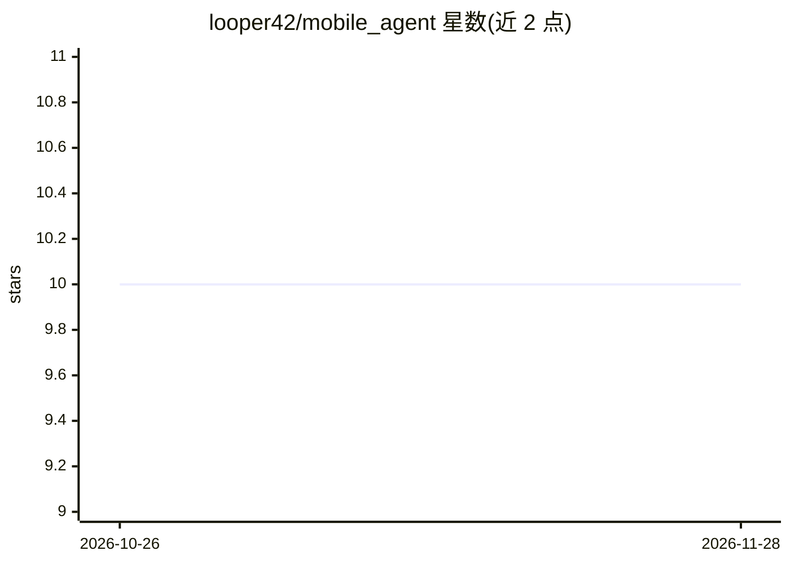

# looper42/mobile_agent

⭐ 10 · Kotlin · Apache-2.0 · 推送 2026-09-28 · [GitHub](https://github.com/looper42/mobile_agent) · 个人维护 · 中文 README

**Android 本地 AI 代理：对话方式操作手机与执行任务**

面向 Android 的开源 AI 聊天与本地工具应用：通过多轮对话访问文件、网络与设备能力，敏感操作前需用户明确批准。支持 OpenAI 兼容模型服务（可配置端点、模型与 API key）与讯飞兼容的语音转录；可读写文件、图片、网页；可选基于 Root/无障碍服务的设备控制、悬浮助手与按工具的权限管理。项目处于早期开发阶段，API 可能变动，README 未给出具体安装步骤，工程文档以中文提供。

## 筛选速览

| 维度 | 判定 | 备注 |
|---|---|---|
| AI 角色 | `ai-native` | 本体是模型或模型工具 |
| 许可风险 | `permissive` | Apache-2.0 |
| 部署形态 | `None` |  |
| 模型依赖 | — | README 未给出锁定关系 |
| 硬件要求 | — | 无带数字的原话,不猜 |
| 安装摩擦 | `low` | 无编译、无系统依赖或容器化 |
| 成熟度 | `idea` | |

## 能力要点

- 多轮对话、上下文压缩与模型用量统计
- OpenAI 兼容模型服务，端点/模型/API key 可配置
- Root/无障碍设备控制、悬浮助手与按工具权限控制
- 技能的安装与管理

## 适用场景

- 在测试设备上让 AI 代理代为操作 Android 手机
- 通过对话读写本地文件、图片与网页内容
- 语音输入经由本地配置的转录服务转文字

## 场景标签

`GUI 自动化` `AI 助手` · 领域:效率与自动化

## 证据(README 行号)

> L5: Mobile Agent is an open-source AI chat and local-tool application for Android. It lets users access file, network, a
> L28: - Support for OpenAI-compatible model services with configurable endpoints, models, and API keys.
> L31: - Optional Root/accessibility-based device control, a floating assistant, and permission controls.

## 星数曲线

2026-10-26 10 → 2026-11-28 10（+0）

---
*卡片 v1 · prompt 1.4 · 生成 2026-11-19 · 置信度 high · 依据 README sha `d1ffbb49ddae` · [字段定义](../../DATASET.md)*
