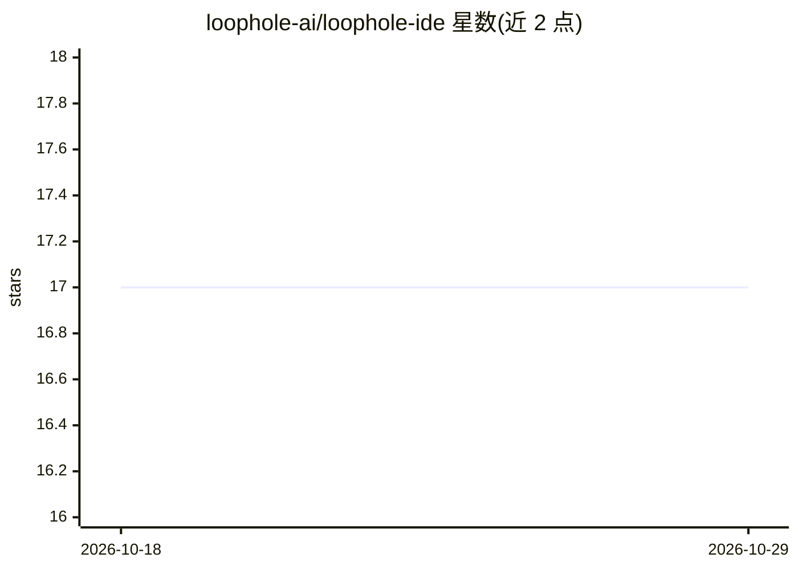

# loophole-ai/loophole-ide

⭐ 17 · TypeScript · AGPL-3.0 · 推送 2026-10-24 · [GitHub](https://github.com/loophole-ai/loophole-ide) · [官网](https://www.loopholeeditor.in) · 组织维护

**开源 AI 代码编辑器：VS Code 分支内嵌 Agent 与补全**

基于 Void Editor（VS Code 分支）的开源桌面代码编辑器，AI 能力内置于编辑器核心：提供 Agent 模式（文件读写、终端命令、并行子代理）、FIM 内联补全、四种聊天模式、Quick Edit、AI 生成 Git 提交信息、语音输入、Token 用量与费用统计、MCP 服务器支持及按功能分配模型。AI 请求从本机直连用户所选 provider，代码不经中转服务器；支持 20+ provider，含 Ollama/vLLM/LM Studio 本地运行时（自动检测）。需从源码构建，要求 Node.js 22+、Python 与 C++ 构建工具。AGPL-3.0 许可。

## 筛选速览

| 维度 | 判定 | 备注 |
|---|---|---|
| AI 角色 | `ai-enhanced` | 去掉 AI 部分产品仍成立 |
| 许可风险 | `viral` | AGPL-3.0 |
| 部署形态 | `None` |  |
| 模型依赖 | local-ok | 支持本地模型 |
| 硬件要求 | — | 无带数字的原话,不猜 |
| 安装摩擦 | `low` | 无编译、无系统依赖或容器化 |
| 成熟度 | — | 结构信号不足 |

## 能力要点

- AI 请求本机直连 provider，无中间服务器，自带 API key 或本地模型
- Agent 模式具备完整工具面：文件编辑、终端命令、ripgrep 搜索、可恢复的并行子代理
- FIM 内联补全（350ms 防抖、20 条缓存、专用补全模型）
- 按功能分配模型：聊天/Quick Edit/补全/Apply/提交信息各有独立模型槽位
- 20+ provider 支持，Ollama/vLLM/LM Studio 自动检测

## 适用场景

- 在熟悉的 VS Code 界面中使用 Agent 完成多步骤编码任务
- 自带 API key 或本地模型进行代码补全与对话，控制代码数据流向
- 为聊天与补全分别配置不同模型并跟踪 Token 费用

## 场景标签

`编码 Agent` · 领域:编码与开发

## 证据(README 行号)

> L20: Loophole is a fully open-source AI-native code editor forked from the Void Editor (itself a fork of VS Code). It in
> L24: It ships with a full agentic engine, inline autocomplete, a four-mode AI chat sidebar, Quick Edit, AI-generated Git

## 星数曲线

2026-10-18 17 → 2026-10-29 17（+0）

---
*卡片 v1 · prompt 1.4 · 生成 2026-10-29 · 置信度 high · 依据 README sha `63f6110f0829` · [字段定义](../../DATASET.md)*
