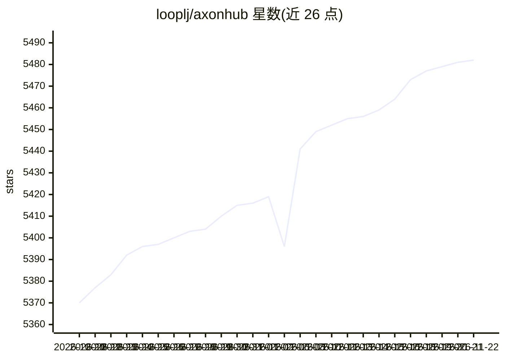

# looplj/axonhub

⭐ 5,482 · Go · Apache-2.0 · 推送 2026-11-20 · [GitHub](https://github.com/looplj/axonhub) · [官网](https://axonhub.reveric.app) · 组织维护 · 中文 README

**给开发者的 AI 网关：任意 SDK 调 100+ 模型，免改代码切换供应商**

以 Go 编写的 AI 网关，将 OpenAI/Anthropic/Gemini 等 SDK 的请求透明转换为各模型供应商兼容格式，免除重构与换 SDK。提供渠道管理、<100ms 故障转移与负载均衡、请求级追踪、实时成本追踪与预算管理，以及 RBAC 访问控制。接口覆盖文本生成、图片生成、重排序与嵌入，实时对话为 Todo。部署后通过初始化向导建管理员账号、添加渠道与 API Key 即可使用。许可证为 Apache-2.0 与 LGPL-3.0 多许可组合。

## 筛选速览

| 维度 | 判定 | 备注 |
|---|---|---|
| AI 角色 | `ai-ecosystem` | LLM/agent 周边工具 |
| 许可风险 | `permissive` | Apache-2.0 |
| 部署形态 | `None` |  |
| 模型依赖 | locked-api |  |
| 硬件要求 | — | 无带数字的原话,不猜 |
| 安装摩擦 | `low` | 无编译、无系统依赖或容器化 |
| 成熟度 | — | 结构信号不足 |

## 能力要点

- 任意 SDK → 任意模型转换，零代码改动切换供应商
- 智能负载均衡与 <100ms 自动故障转移
- 请求级完整追踪与每次调用成本明细追踪
- 企业级 RBAC、用量配额与数据隔离

## 适用场景

- 统一接入 OpenAI、Claude、Gemini、DeepSeek 等多个模型渠道
- 在 GPT-4 与 Claude 之间切换而无需改业务代码
- 团队用量配额、成本追踪与预算管理
- 集中监控请求时间线以定位接口问题

## 场景标签

`模型网关` `LLM 可观测性` · 领域:Agent 开发

## 证据(README 行号)

> L79: **AxonHub 是 AI 网关，让你无需改动一行代码即可切换模型供应商。**
> L81: 无论你使用的是 OpenAI SDK、Anthropic SDK 还是任何 AI SDK，AxonHub 都会透明地将你的请求转换为与任何支持的模型供应商兼容的格式。无需重构，无需更换 SDK——只需更改配置即可。
> L98: |⚡ **智能负载均衡**|<100ms 自动故障转移。始终路由到最健康的渠道。|

## 星数曲线

2026-10-20 5,370 → 2026-11-22 5,482（+112）

---
*卡片 v1 · prompt 1.4 · 生成 2026-11-22 · 置信度 high · 依据 README sha `c9b397d3dc96` · [字段定义](../../DATASET.md)*
