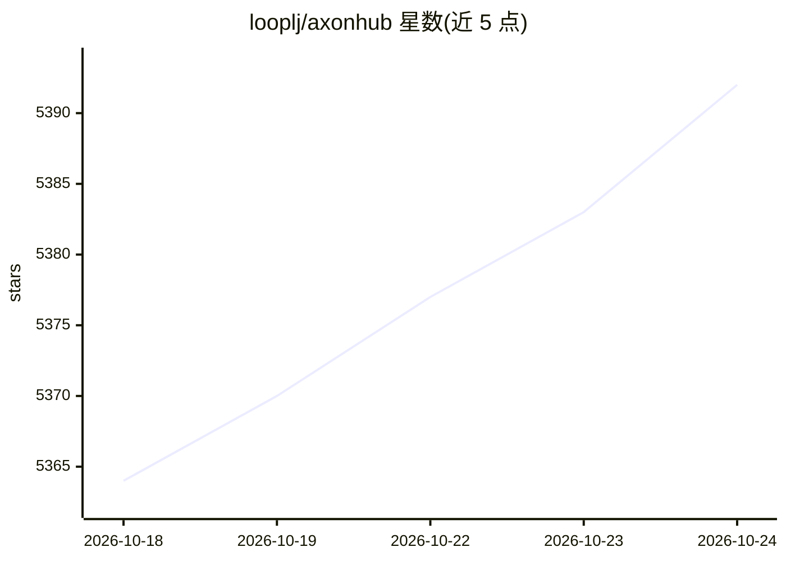

# looplj/axonhub

⭐ 5,396 · Go · Apache-2.0 · 推送 2026-10-24 · [GitHub](https://github.com/looplj/axonhub) · [官网](https://axonhub.onrender.com/) · 个人维护 · 中文 README

**开源 AI 网关：任意 SDK 调用 100+ LLM，统一路由与追踪**

用 Go 编写的 AI 网关/开发平台：将 OpenAI、Anthropic、Gemini 等任一 SDK 的请求透明转换并路由到多种模型供应商，零代码改动即可切换模型。提供渠道管理、<100ms 自动故障转移、智能负载均衡、实时成本追踪、线程级请求追踪、企业级 RBAC 与用量配额。支持文本生成、图片生成、重排序与 Embedding API，已适配 OpenAI/Anthropic/智谱/Moonshot/DeepSeek/豆包/Gemini/Jina/OpenRouter 等提供商，AWS Bedrock 与 Google Cloud 适配为测试中。部署通过让 Agent 读取 deploy-axonhub 指引完成，README 标注 Docker Ready。

## 筛选速览

| 维度 | 判定 | 备注 |
|---|---|---|
| AI 角色 | `ai-ecosystem` | LLM/agent 周边工具 |
| 许可风险 | `permissive` | Apache-2.0 |
| 部署形态 | `None` |  |
| 模型依赖 | locked-api |  |
| 硬件要求 | — | 无带数字的原话,不猜 |
| 安装摩擦 | `low` | 无编译、无系统依赖或容器化 |
| 成熟度 | — | 结构信号不足 |

## 能力要点

- 任意 SDK ↔ 任意模型供应商的请求透明转换
- <100ms 自动故障转移与智能负载均衡
- 实时成本追踪、完整请求时间线与企业级 RBAC
- 支持文本生成/图片生成/重排序/Embedding 四类 API

## 适用场景

- 不改动代码在多个模型供应商之间切换与降级
- 团队统一管理 API Key、配额与成本
- 追踪 Agent 请求链路定位问题

## 场景标签

`模型网关` `LLM 可观测性` · 领域:Agent 开发

## 证据(README 行号)

> L81: **AxonHub 是 AI 网关，让你无需改动一行代码即可切换模型供应商。**
> L86: - 🔒 **供应商锁定** - 从 GPT-4 瞬间切换到 Claude 或 Gemini
> L97: |🔄 **任意 SDK → 任意模型**|用 OpenAI SDK 调用 Claude，或用 Anthropic SDK 调用 GPT。零代码改动。|

## 星数曲线

2026-10-18 5,364 → 2026-10-24 5,392（+28）

---
*卡片 v1 · prompt 1.4 · 生成 2026-10-20 · 置信度 high · 依据 README sha `d711d6f6e628` · [字段定义](../../DATASET.md)*
