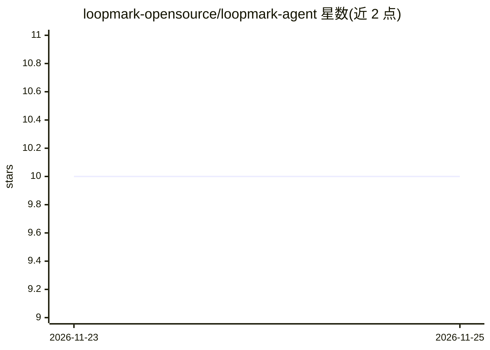

# loopmark-opensource/loopmark-agent

⭐ 10 · Python · MIT · 推送 2026-11-15 · [GitHub](https://github.com/loopmark-opensource/loopmark-agent) · 组织维护

**面向营销人员的 LangGraph AI 助手：社媒/邮件/客诉/线索**

基于 LangGraph 的开源营销助手，包含 Complaints、Posting、Funnel 三个子 Agent，由路由器按自然语言请求自动分发。功能覆盖客诉记录与回复草拟、多平台帖文与邮件活动生成、内容日历、8 阶段线索漏斗与评分、受众画像（商业档案 + 网页分析 + CRM CSV/JSON 导入）。支持经 Twitter/LinkedIn API 或 Buffer 立即发布与定时发布，后台调度器发布到期队列。数据以 JSON 本地存储于 data/，需自备 OpenAI API key，可选 FastAPI REST 接口与 LangSmith 追踪。

## 筛选速览

| 维度 | 判定 | 备注 |
|---|---|---|
| AI 角色 | `ai-native` | 本体是模型或模型工具 |
| 许可风险 | `permissive` | MIT |
| 部署形态 | `library` | 以包/库形式分发 |
| 模型依赖 | — | README 未给出锁定关系 |
| 硬件要求 | — | 无带数字的原话,不猜 |
| 安装摩擦 | `low` | 无编译、无系统依赖或容器化 |
| 成熟度 | — | 结构信号不足 |

## 能力要点

- 三个 ReAct 子 Agent（Complaints/Posting/Funnel），路由器自动分发请求
- 立即发布至 Twitter/LinkedIn，或经 Buffer 一键排期多平台
- 线索漏斗 8 阶段管理与 0–100 评分
- 网页 URL 分析生成受众画像，支持 CRM CSV/JSON 导入

## 适用场景

- 为 Twitter/LinkedIn 生成帖文并定时自动发布
- 批量草拟邮件活动与 drip 序列
- 记录、分类并跟进客户投诉
- 导入 CRM 分段数据生成受众画像

## 场景标签

`AI 写作` · 领域:内容生成

## 证据(README 行号)

> L17: A LangGraph-powered AI marketing assistant with three specialised sub-agents. You talk to it in plain English — a r
> L24: |**Posting**|Create social content, email campaigns, content calendars, and **automatically publish** to social pla
> L117: All agents are **ReAct** agents built with LangGraph. Data is persisted as JSON in `data/`.

## 星数曲线

2026-11-23 10 → 2026-11-25 10（+0）

---
*卡片 v1 · prompt 1.4 · 生成 2026-11-23 · 置信度 high · 依据 README sha `b6a5af1c0de6` · [字段定义](../../DATASET.md)*
