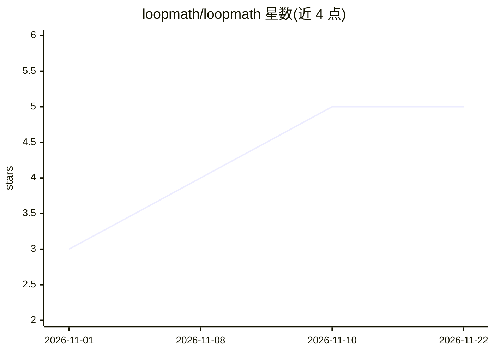

# loopmath/loopmath

⭐ 5 · Python · MIT · 推送 2026-11-20 · [GitHub](https://github.com/loopmath/loopmath) · [官网](https://loopmath.ai) · 个人维护

**为编排 agent 预测任务工作流成败与成本，并从运行日志学习的 CLI**

loopmath 是一个供编排 agent（Claude Code、Codex、herdr 或自有工具）调用的本地 CLI：任务前预测常用 agent 工作流的接受概率与 token/美元成本，展示成功-成本曲线上的备选方案与探索选项；任务后从 Claude Code 和 Codex 日志读取 token 成本，写入预测与实际对照的 receipt 并重新拟合。它自身不启动或协调 agent（实验性的 loopmath harness 除外），一切本地运行，仅连接 pypi.org 做每日更新检查。需 Python 3.11+，通过 pipx/uv/pip 安装。

## 筛选速览

| 维度 | 判定 | 备注 |
|---|---|---|
| AI 角色 | `ai-ecosystem` | LLM/agent 周边工具 |
| 许可风险 | `permissive` | MIT |
| 部署形态 | `library` | 以包/库形式分发 |
| 模型依赖 | local-ok | 支持本地模型 |
| 硬件要求 | — | 无带数字的原话,不猜 |
| 安装摩擦 | `low` | 无编译、无系统依赖或容器化 |
| 成熟度 | — | 结构信号不足 |

## 能力要点

- 任务前预测成功率与成本，给出成功-成本曲线上的备选与探索选项
- 从 Claude Code 与 Codex 日志只读解析 token 成本，生成预测/实际 receipt
- skill install 向 Claude Code 与 Codex 的 skills 目录写入技能文件，支持 --dry-run 与可重复安装
- 自带基于内部实验的先验，无历史也可给出 recommend；labeller 可走 claude/codex CLI、本地命令（如 ollama）或跳过

## 适用场景

- 让编排 agent 在派发编码任务前用 loopmath recommend 选工作流、模型与 effort
- 任务完成后从日志自动记录成本与结果并重新拟合
- 用 blind judge 对照运行目标工作流与探索选项，判断哪个改动更好
- 用本地 ollama 模型给历史会话打标签，数据不出本机

## 场景标签

 · 领域:开发者工具/agent 工作流管理

## 证据(README 行号)

> L3: loopmath helps an orchestrator agent choose how to run a coding task, and learns from how it went.
> L7: loopmath never starts or coordinates agents, except `loopmath harness` (experimental), which runs Claude Code sessio

## 星数曲线

2026-11-01 3 → 2026-11-22 5（+2）

---
*卡片 v1 · prompt 1.4 · 生成 2026-11-21 · 置信度 high · 依据 README sha `d305f8526928` · [字段定义](../../DATASET.md)*
