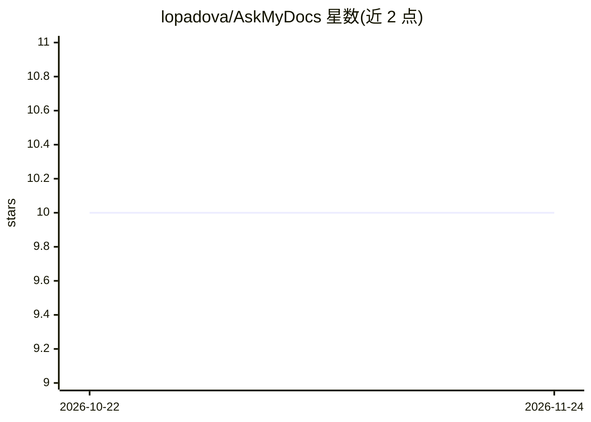

# lopadova/AskMyDocs

⭐ 10 · PHP · MIT · 推送 2026-11-22 · [GitHub](https://github.com/lopadova/AskMyDocs) · [官网](https://askmydocs.padosoft.com) · 组织维护

**可自托管的企业知识 AI hub：RAG+知识图谱问答**

基于 Laravel 13 + PostgreSQL + pgvector 的自托管企业知识平台：摄取 markdown/text/PDF/DOCX 及 OCR 扫描件，构建带人工晋升门控的类型化知识图谱，通过 pgvector+FTS+reranker 的混合检索提供流式 RAG 问答并展示来源；同一知识以 MCP 工具暴露给 agentic 客户端，附带 React 管理后台（KPI、KB 编辑器、日志、内容缺口分析）。定位为 Glean/Notion AI/ChatGPT Enterprise 的开源 on-prem 替代，MIT 许可，面向需要 GDPR/AI Act 合规与 PII 脱敏的企业团队。

## 筛选速览

| 维度 | 判定 | 备注 |
|---|---|---|
| AI 角色 | `ai-native` | 本体是模型或模型工具 |
| 许可风险 | `permissive` | MIT |
| 部署形态 | `library` | 以包/库形式分发 |
| 模型依赖 | — | README 未给出锁定关系 |
| 硬件要求 | — | 无带数字的原话,不猜 |
| 安装摩擦 | `low` | 无编译、无系统依赖或容器化 |
| 成熟度 | — | 结构信号不足 |

## 能力要点

- 混合检索 RAG（pgvector + FTS + reranker）与流式问答、来源可见
- 类型化知识图谱与三阶段人工晋升管道（suggest→candidates→promote）
- MCP 工具暴露知识库，对接 Claude Desktop/Claude Code/Cursor 等客户端
- OCR 文档摄取（docling/Mistral OCR/vision-LLM/tesseract 可插拔驱动）

## 适用场景

- 企业团队把架构决策/runbook/规范沉淀为可问答的知识库
- 受监管行业需要字段级 PII 脱敏的 RAG 部署
- 通过 MCP 让 agent 客户端访问企业知识
- 希望在本地自托管、避免按席位付费 SaaS 合同

## 场景标签

`文档问答` `知识图谱` `OCR` · 领域:知识与检索

## 证据(README 行号)

> L9: AskMyDocs is a self-hostable AI hub for enterprise knowledge. It fuses
> L45: **What.** AskMyDocs is an **AI hub for enterprise knowledge** built on
> L70: **For whom.** Enterprise teams ingesting their architectural decisions

## 星数曲线

2026-10-22 10 → 2026-11-24 10（+0）

---
*卡片 v1 · prompt 1.4 · 生成 2026-11-19 · 置信度 mid · 依据 README sha `dcc1cf77319f` · [字段定义](../../DATASET.md)*
