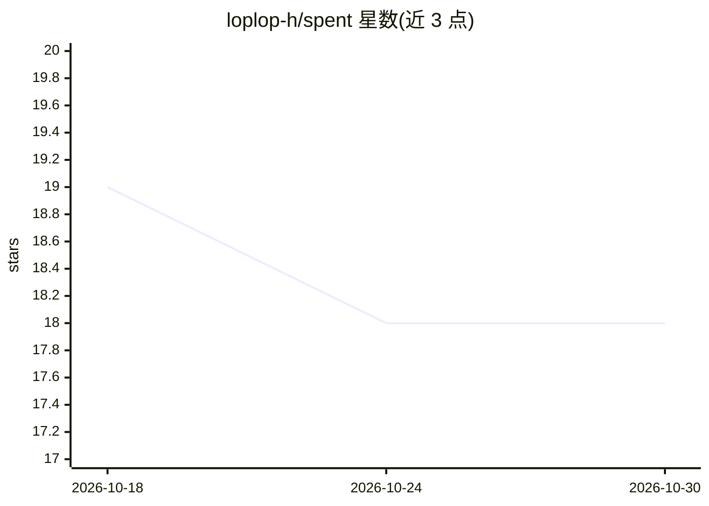

# loplop-h/spent

⭐ 18 · Python · MIT · 推送 2026-04-04 · [GitHub](https://github.com/loplop-h/spent) · 个人维护

**追踪 Claude Code 会话成本与效率评分的本地 CLI 工具**

面向 Claude Code 用户的 Python CLI/TUI 工具：通过安装到 ~/.claude/settings.json 的三个 hook（PostToolUse/SessionStart/Stop）记录每次工具调用，将操作分类为 productive/neutral/wasted，输出 0-100 效率评分。按字符数估算 token，结合 Opus/Sonnet/Haiku 定价本地计算成本，无需 API key 或网络请求。提供终端实时面板、Web 面板、JSON 导出与 /spent 技能。数据仅存于本地 JSONL 文件。

## 筛选速览

| 维度 | 判定 | 备注 |
|---|---|---|
| AI 角色 | `ai-ecosystem` | LLM/agent 周边工具 |
| 许可风险 | `permissive` | MIT |
| 部署形态 | `library` | 以包/库形式分发 |
| 模型依赖 | — | README 未给出锁定关系 |
| 硬件要求 | — | 无带数字的原话,不猜 |
| 安装摩擦 | `low` | 无编译、无系统依赖或容器化 |
| 成熟度 | — | 结构信号不足 |

## 能力要点

- hook 系统记录工具调用并本地估算 token 与成本
- 工具调用三级分类（productive/neutral/wasted）与加权效率评分
- 实时终端面板、Web 面板与 /spent 会话内技能
- 支持 Opus/Sonnet/Haiku 多模型定价，无网络请求

## 适用场景

- 查看每日 Claude Code 使用花了多少钱
- 分析哪些会话存在大量失败命令或重复读取
- 在会话内用 /spent 快速查看当前成本与效率

## 场景标签

 · 领域:开发者工具/LLM 监控

## 证据(README 行号)

> L12: **spent** tracks every tool use, classifies it as productive, neutral, or wasted, and gives you an efficiency score
> L24: spent cc setup    # install Claude Code hooks (once)
> L58: Claude Code hooks fire on every tool use. spent logs each event to a local JSONL file at `~/.spent/claude-sessions.

## 星数曲线

2026-10-18 19 → 2026-10-30 18（-1）

---
*卡片 v1 · prompt 1.4 · 生成 2026-10-29 · 置信度 high · 依据 README sha `b7d69993964d` · [字段定义](../../DATASET.md)*
