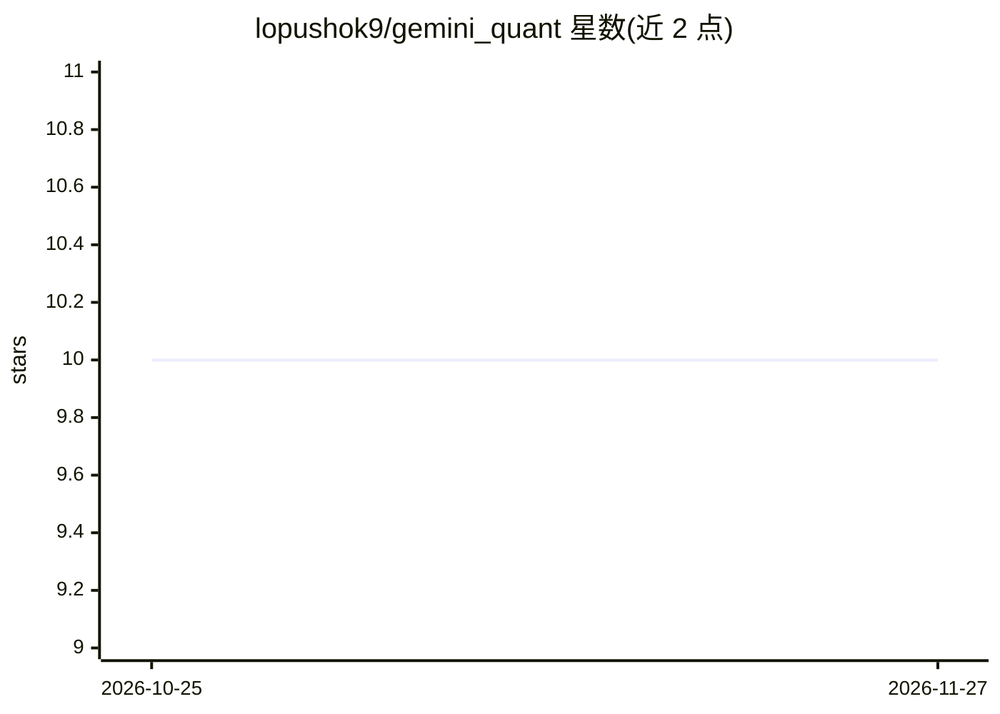

# lopushok9/gemini_quant

⭐ 10 · TypeScript · MIT · 推送 2026-01-30 · [GitHub](https://github.com/lopushok9/gemini_quant) · [官网](https://www.quantycli.tech/) · 个人维护

**将 Gemini CLI 变成市场研究分析师的金融分析扩展套件**

基于 Gemini CLI 扩展机制构建的金融分析工具集：核心 AI Investor 引擎通过指令框架驱动 Gemini 执行多层市场尽调（财务表现、市场定位、技术面/期权流/内部人信号），输出带 BUY/SELL/HOLD 评级、目标价与风险分析的研究报告，另提供 Polymarket 预测市场扫描与 EV 分析命令。附带的 Hyperliquid TUI/头寸监控/大额交易监控、Polymarket 巨鲸监控、SEC Form 4 内部人交易追踪等工具独立于 AI 运行。需先安装官方 Gemini CLI，分析命令加载最长需 3 分钟。

## 筛选速览

| 维度 | 判定 | 备注 |
|---|---|---|
| AI 角色 | `ai-native` | 本体是模型或模型工具 |
| 许可风险 | `permissive` | MIT |
| 部署形态 | `library` | 以包/库形式分发 |
| 模型依赖 | — | README 未给出锁定关系 |
| 硬件要求 | — | 无带数字的原话,不猜 |
| 安装摩擦 | `low` | 无编译、无系统依赖或容器化 |
| 成熟度 | — | 结构信号不足 |

## 能力要点

- 通过 gemini extension install 安装的 Gemini CLI 扩展
- 三类分析命令：长期投资、短线交易、杠杆交易分析
- Polymarket 市场扫描与期望值（EV）深度分析
- Hyperliquid/Polymarket/SEC 实时监控工具（WebSocket）

## 适用场景

- 生成个股的长期研究报告与买卖评级
- 扫描 Polymarket 预测市场寻找交易机会
- 实时监控 Hyperliquid 大额头寸与接近清算的仓位
- 追踪 SEC Form 4 高管买卖记录

## 场景标签

`金融量化` · 领域:学习与行业

## 证据(README 行号)

> L4: **Gemini Quant** is a financial analysis tool designed to transform Gemini CLI into a research analyst.
> L10: The core of this repository is the **AI Investor** engine—a research framework that directs Gemini to perform multi
> L31: gemini extension install .

## 星数曲线

2026-10-25 10 → 2026-11-27 10（+0）

---
*卡片 v1 · prompt 1.4 · 生成 2026-11-19 · 置信度 high · 依据 README sha `9fbeeb5da4b7` · [字段定义](../../DATASET.md)*
