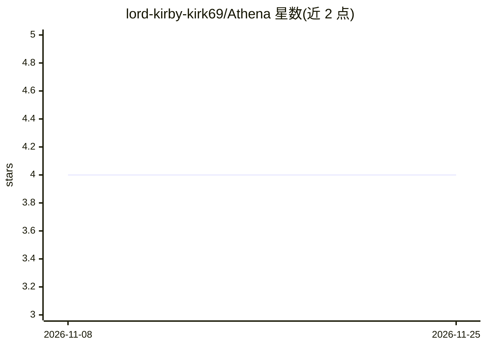

# lord-kirby-kirk69/Athena

⭐ 4 · 推送 2026-11-08 · [GitHub](https://github.com/lord-kirby-kirk69/Athena) · 个人维护

**跨平台桌面/移动端 AI 助手客户端，支持云端与本地模型**

基于 Tauri 2、React、TypeScript 与 Rust 构建的跨平台个人 AI 助手应用，覆盖 Windows、macOS、Linux 与 Android。功能包括多会话对话与流式输出、语音助手（唤醒词、ElevenLabs 语音）、屏幕截图感知助手、令牌用量估算、插件架构与可定制界面。模型接入分两类：OpenAI 兼容 API、Gemini、Groq、Anthropic、Ollama 等云端/服务端提供方，以及通过 llama.cpp 运行 GGUF 模型的本地离线推理。安装包随 release 发布，移动端功能与桌面端分开实现且部分能力标注为计划中。

## 筛选速览

| 维度 | 判定 | 备注 |
|---|---|---|
| AI 角色 | `ai-native` | 本体是模型或模型工具 |
| 许可风险 | `none` | — |
| 部署形态 | `desktop` | 安装包/桌面程序 |
| 模型依赖 | local-ok | 支持本地模型 |
| 硬件要求 | — | 无带数字的原话,不猜 |
| 安装摩擦 | `low` | 无编译、无系统依赖或容器化 |
| 成熟度 | — | 结构信号不足 |

## 能力要点

- 四平台分发：.exe/.msi、.dmg、.AppImage/.deb、.apk
- llama.cpp + GGUF 本地离线推理，支持 Hugging Face 模型浏览与导入
- 语音助手：唤醒词激活与 ElevenLabs 集成
- 截图捕获与视觉模型的屏幕感知助手

## 适用场景

- 在同一应用里切换云端模型与本地模型对话
- 用语音免手操作与设备上的 AI 助手交互
- 对屏幕截图内容提问获得上下文帮助
- 离线环境下在本地设备上运行 GGUF 模型

## 场景标签

`AI 助手` · 领域:对话与助手

## 证据(README 行号)

> L5: Athena AI is a cross-platform AI-powered personal assistant designed to bring intelligent conversations, voice inter
> L163: - OpenAI-compatible API providers.

## 星数曲线

2026-11-08 4 → 2026-11-25 4（+0）

---
*卡片 v1 · prompt 1.4 · 生成 2026-11-21 · 置信度 high · 依据 README sha `ccd89c172bd1` · [字段定义](../../DATASET.md)*
