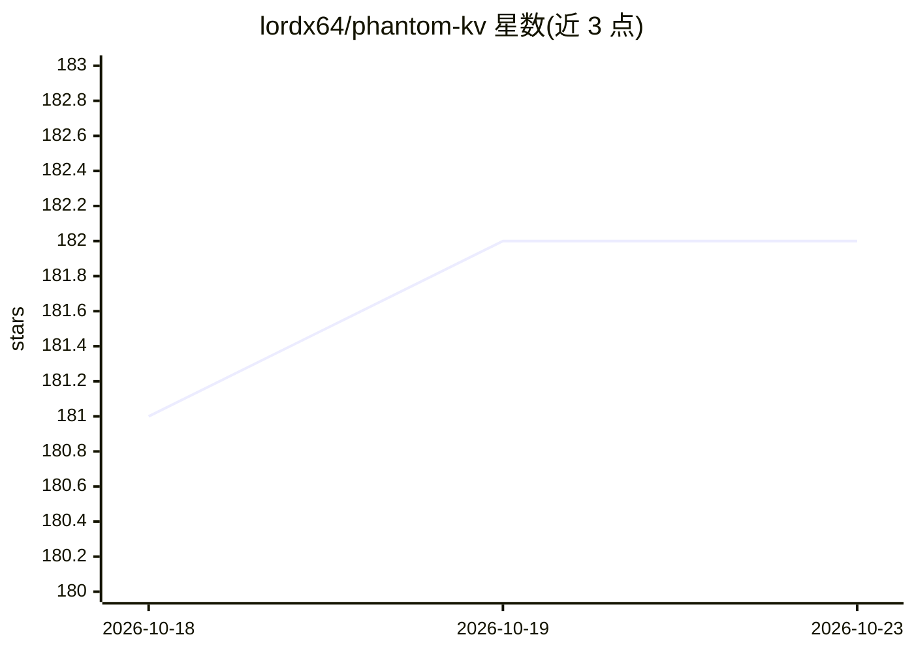

# lordx64/phantom-kv

⭐ 182 · Python · MIT · 推送 2026-09-21 · [GitHub](https://github.com/lordx64/phantom-kv) · 个人维护

**以可加载 KV-cache 移植片移除 LLM 拒答的工具链**

面向 LLM 的拒答移除工具：不改权重、不做拒绝方向投影，而是离线训练一组逐层 K/V 张量（graft），在推理时拼接进 KV cache 的固定位置 0..N，通过模型自身注意力实现引导；卸载后基模型字节级还原。训练基于 abliteration 的双目标（抑制有害拒答、无害输入上对基模型最小化 KL）。声称架构无关、推理引擎无关（vLLM/HF transformers/llama.cpp 均有 cache 通道），当前仅在 Qwen3 dense 上验证，跨架构与跨量化为路线图项。结果以 Qwen3-4B 的 60 题有害套件、KL 与持久性测量呈现，graft 约 18MB。

## 筛选速览

| 维度 | 判定 | 备注 |
|---|---|---|
| AI 角色 | `ai-ecosystem` | LLM/agent 周边工具 |
| 许可风险 | `permissive` | MIT |
| 部署形态 | `library` | 以包/库形式分发 |
| 模型依赖 | — | README 未给出锁定关系 |
| 硬件要求 | — | 无带数字的原话,不猜 |
| 安装摩擦 | `low` | 无编译、无系统依赖或容器化 |
| 成熟度 | `idea` | |

## 能力要点

- 零权重修改的 KV-cache graft，卸载后基模型字节级还原
- 每请求可热切换的 graft 变体（剂量即工件）
- 当前仅在 Qwen3（dense）部署验证，训练新模型约一小时（笔记本）
- 结果含留出集迁移与 2-4k token 半衰期的持久性测量

## 适用场景

- 移除本地 LLM 的拒答行为且保留基模型权重
- 研究会话中按需开启/恢复安全护栏的 steering 机制
- 对比 abliteration 等权重/激活干预方法的实验基线

## 场景标签

 · 领域:LLM 可解释性/模型引导

## 证据(README 行号)

> L64: A phantom graft is a small bank of per-layer key/value tensors, trained
> L180: - **HF transformers** — first-class `past_key_values` (what this repo uses);
> L204: Scoreboard: **Qwen3-4B-Instruct-2507**, hardened 60-prompt harmful suite,

## 星数曲线

2026-10-18 181 → 2026-10-23 182（+1）

---
*卡片 v1 · prompt 1.4 · 生成 2026-10-22 · 置信度 mid · 依据 README sha `9c97d1c3bdde` · [字段定义](../../DATASET.md)*
