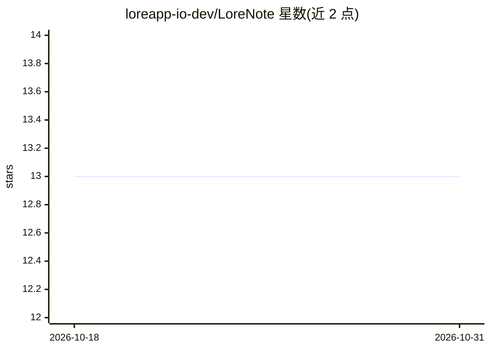

# loreapp-io-dev/LoreNote

⭐ 13 · TypeScript · AGPL-3.0 · 推送 2026-01-31 · [GitHub](https://github.com/loreapp-io-dev/LoreNote) · [官网](https://lorenote.app) · 组织维护 · 中文 README

**JSON Schema 驱动块编辑的本地优先桌面笔记应用**

基于 Tauri 2 与 React 19 的桌面笔记应用：每个块由 JSON Schema 定义而非硬编码组件，用户可直接编写 JSON 定义自己的组件并分享，支持数据绑定、条件渲染、事件处理等交互能力；提供多 Vault、Wiki 链接、多标签、中英文切换等功能。AI 方面处于规划阶段：计划利用 JSON 格式便于 AI 生成的特性深度集成 AI 工作流以简化组件创建。面向个人用户做本地笔记与知识管理，开发者可从源码构建（需 Node.js、Rust 与 Tauri 系统依赖），发布流程自动生成三平台安装包。

## 筛选速览

| 维度 | 判定 | 备注 |
|---|---|---|
| AI 角色 | `ai-enhanced` | 去掉 AI 部分产品仍成立 |
| 许可风险 | `viral` | AGPL-3.0 |
| 部署形态 | `library` | 以包/库形式分发 |
| 模型依赖 | — | README 未给出锁定关系 |
| 硬件要求 | — | 无带数字的原话,不猜 |
| 安装摩擦 | `medium` | 含编译或系统依赖之一 |
| 成熟度 | `idea` | |

## 能力要点

- 每个块由 JSON Schema 定义，用户无需编码即可自定义组件并分享（如 2KB 的 habit-tracker.json）
- JSON Schema 支持数据绑定、条件/循环渲染、事件处理与计算表达式
- 多 Vault、Wiki 链接 [[页面名]]、多标签、软删除、中英文切换
- 内置 Schema 编辑器、模板库与调试控制台等开发者工具

## 适用场景

- 用块编辑器做个人笔记与知识库管理
- 通过编写 JSON 自定义组件（如习惯追踪器）并分享给他人
- 用 [[Wiki 链接]] 组织页面间引用关系

## 场景标签

`知识库管理` · 领域:知识与检索

## 证据(README 行号)

> L22: LoreNote is a modern desktop note-taking application with a unique approach: **every block is defined by JSON Schem
> L78: **JSON is the format AI excels at generating.** LoreNote will deeply integrate AI workflows, making component creat

## 星数曲线

2026-10-18 13 → 2026-10-31 13（+0）

---
*卡片 v1 · prompt 1.4 · 生成 2026-10-31 · 置信度 mid · 依据 README sha `b9eda809f9e7` · [字段定义](../../DATASET.md)*
