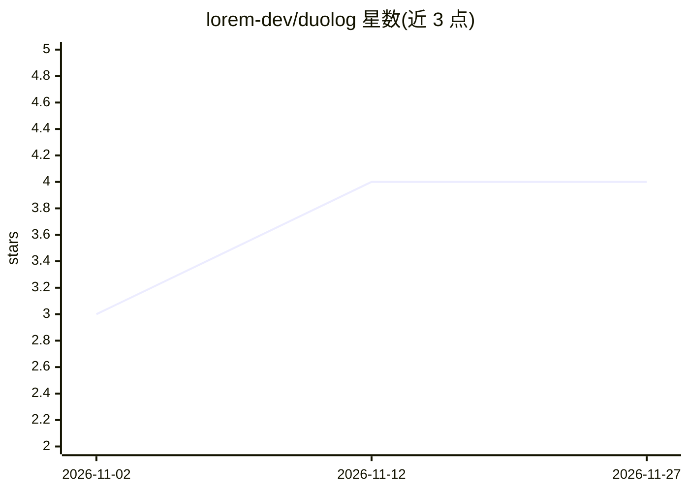

# lorem-dev/duolog

⭐ 4 · Go · Apache-2.0 · 推送 2026-11-26 · [GitHub](https://github.com/lorem-dev/duolog) · 组织维护

**让 Claude Code 与 Codex 在同一项目中结对协作的 CLI 工具**

duolog 将 Claude Code 和 Codex 两个 agent 会话接入同一项目：通过角色（lead/worker/planner/peer）指定由哪个 agent 和模型承担哪类工作，会话间经由 .duolog/ 目录下的文件总线交换短消息而非大段上下文。gate 按项目规则检查 worker 的每条命令，支持按套餐设置压缩窗口以控制每轮重读上下文的成本，并附带交接方式与压缩窗口的成本研究。通过 Claude/Codex 一行命令安装，Apache 2.0 许可，默认开启本地遥测可关闭。

## 筛选速览

| 维度 | 判定 | 备注 |
|---|---|---|
| AI 角色 | `ai-ecosystem` | LLM/agent 周边工具 |
| 许可风险 | `permissive` | Apache-2.0 |
| 部署形态 | `None` |  |
| 模型依赖 | — | README 未给出锁定关系 |
| 硬件要求 | — | 无带数字的原话,不猜 |
| 安装摩擦 | `low` | 无编译、无系统依赖或容器化 |
| 成熟度 | — | 结构信号不足 |

## 能力要点

- lead/worker/planner/peer 角色机制，按角色指定 agent 与模型分工
- .duolog/ 文件总线传递消息、请求与结果，避免粘贴大段上下文
- gate 按 project rules 检查 worker 每条命令
- 可配置压缩窗口（workers.compact_window）控制每轮上下文重读成本

## 适用场景

- 在一个项目里同时使用 Claude Code 和 Codex 分工协作
- 通过角色委托把审查、规划等任务交给另一个 agent 会话
- 控制长会话下多 agent 协作的 token 成本

## 场景标签

`多智能体` `编码 Agent` · 领域:Agent 开发

## 证据(README 行号)

> L10: duolog pairs Claude Code and Codex in one project. Roles select the agent and
> L11: model; sessions exchange short messages on a file bus.
> L20: <code>.duolog/</code> carries messages, asks and results.

## 星数曲线

2026-11-02 3 → 2026-11-27 4（+1）

---
*卡片 v1 · prompt 1.4 · 生成 2026-11-21 · 置信度 high · 依据 README sha `b572cad18741` · [字段定义](../../DATASET.md)*
