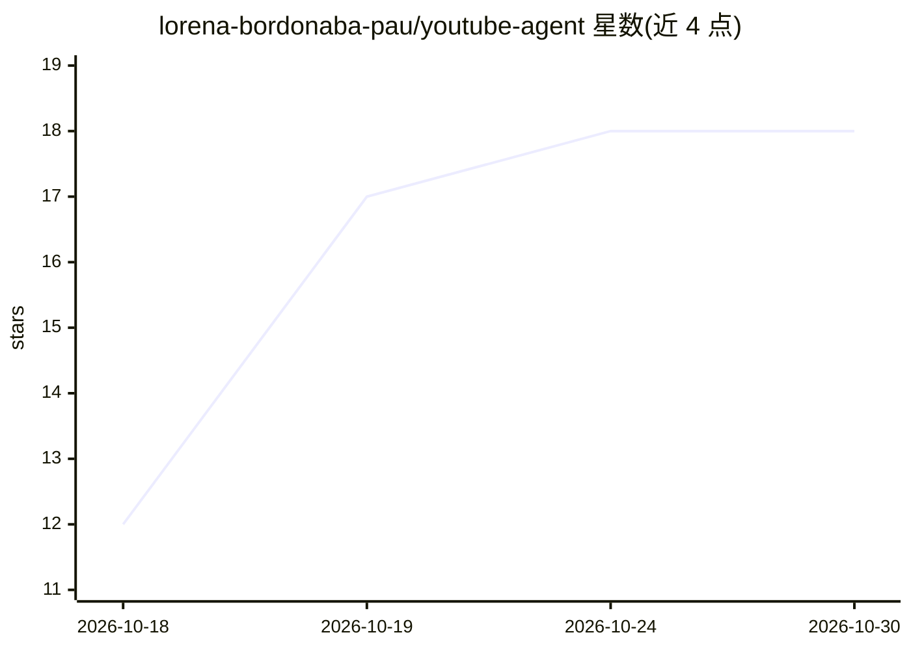

# lorena-bordonaba-pau/youtube-agent

⭐ 18 · Python · MIT · 推送 2026-09-29 · [GitHub](https://github.com/lorena-bordonaba-pau/youtube-agent) · 个人维护 · 中文 README

**分析 YouTube 频道的 Claude Code 智能体，每个数据标注来源**

运行于 Claude Code 的频道分析智能体套件：以 YouTube Data API 真实数据为基础，31 个工具（数据/图像/实用）、22 个技能、2 个子智能体（youtube-strategist 与 claim-checker），覆盖策略制定、竞品对标、标题缩略图评分、SEO 关键词、脚本撰写与变现预测。核心机制是每个工具返回 source 字段，运行契约强制智能体区分实测数据与推断；公开 API 不含 CTR/展示量，需手动导入 Studio CSV；评分量表初始未校准。只读权限，不代为发布内容。

## 筛选速览

| 维度 | 判定 | 备注 |
|---|---|---|
| AI 角色 | `ai-native` | 本体是模型或模型工具 |
| 许可风险 | `permissive` | MIT |
| 部署形态 | `library` | 以包/库形式分发 |
| 模型依赖 | locked-api |  |
| 硬件要求 | — | 无带数字的原话,不猜 |
| 安装摩擦 | `low` | 无编译、无系统依赖或容器化 |
| 成熟度 | — | 结构信号不足 |

## 能力要点

- 31 个工具均返回 source 字段，区分实测值与推断
- 22 个技能含固定工具执行顺序，claim-checker 子智能体交付前核验数字
- 缩略图生成后逐像素验证 16:9 并裁剪信箱边
- 公开 API 无 CTR，需用 ingest_studio_csv.py 手动导入 Studio 数据

## 适用场景

- 我想要基于真实 API 数据的频道健康报告
- 我想对标竞品频道并生成竞品看板网页
- 我想让 AI 用我自己的语言风格写脚本、起标题、做缩略图

## 场景标签

`数据分析` `图像生成` `AI 写作` · 领域:效率与自动化

## 证据(README 行号)

> L5: A Claude Code agent that analyses your channel with real
> L25: Agent:  [runs yt_report.py, yt_analytics.py and yt_outliers_channels.py]
> L67: Then open Claude Code in the directory and run **`/kickoff`**. It builds the

## 星数曲线

2026-10-18 12 → 2026-10-30 18（+6）

---
*卡片 v1 · prompt 1.4 · 生成 2026-10-29 · 置信度 mid · 依据 README sha `bbbfad68b065` · [字段定义](../../DATASET.md)*
