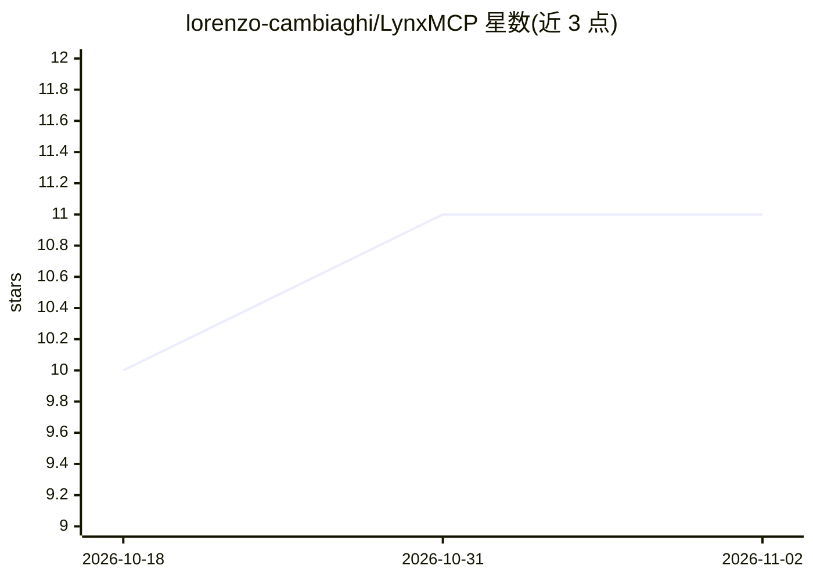

# lorenzo-cambiaghi/LynxMCP

⭐ 11 · Python · Apache-2.0 · 推送 2026-09-07 · [GitHub](https://github.com/lorenzo-cambiaghi/LynxMCP) · [官网](https://github.com/lorenzo-cambiaghi/LynxMCP) · 个人维护

**本地代码检索 MCP 服务器：回答 grep 解决不了的代码结构问题**

面向 MCP 客户端（Claude Code、Cursor 等）的本地代码检索服务器：用 Tree-sitter 做 AST 感知分块，BM25 + dense 混合检索（RRF 融合，可选 cross-encoder 重排），可选代码知识图谱回答调用关系、继承链与修改影响面（blast radius）。可将代码库、文档站点与 PDF 作为并列来源索引。模型经 ONNX Runtime 运行，磁盘约 460 MB，无 PyTorch，无遥测与代码上传；提供 CLI、本地 HTTP API、Web UI 与 macOS/Windows 双击安装包。

## 筛选速览

| 维度 | 判定 | 备注 |
|---|---|---|
| AI 角色 | `ai-ecosystem` | LLM/agent 周边工具 |
| 许可风险 | `permissive` | Apache-2.0 |
| 部署形态 | `desktop` | 安装包/桌面程序 |
| 模型依赖 | — | README 未给出锁定关系 |
| 硬件要求 | — | 无带数字的原话,不猜 |
| 安装摩擦 | `medium` | 含编译或系统依赖之一 |
| 成熟度 | — | 结构信号不足 |

## 能力要点

- 17 个分层工具（search/graph_query/impact 等），三档 profile 控制上下文开销
- Tree-sitter 解析 18+ 语言，混合检索 + 可选代码知识图谱
- 完全本地运行，ONNX Runtime 无 PyTorch，约 460 MB
- 代码、公开文档站点与 PDF 作为并列来源检索

## 适用场景

- 让 AI 编程助手在大代码库中查找定义、调用者与修改影响面
- 把项目实际使用的框架版本文档索引为回答来源
- 代码评审中只检索相对基线分支的变更文件

## 场景标签

`知识图谱` `RAG` `语义搜索` · 领域:知识与检索

## 证据(README 行号)

> L3: **LynxMCP is a 100% local MCP server for the code questions grep can't answer: what calls this, what breaks if I cha
> L10: LynxMCP MCP server
> L40: Then register Lynx in your MCP client. Claude Code is shown; the full guide covers Cursor, Antigravity, and generic

## 星数曲线

2026-10-18 10 → 2026-11-02 11（+1）

---
*卡片 v1 · prompt 1.4 · 生成 2026-11-02 · 置信度 high · 依据 README sha `a6525a7b1dcd` · [字段定义](../../DATASET.md)*
