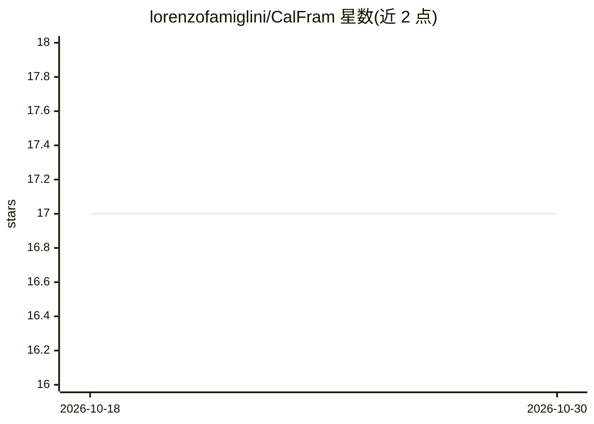

# lorenzofamiglini/CalFram

⭐ 17 · Python · MIT · 推送 2026-09-22 · [GitHub](https://github.com/lorenzofamiglini/CalFram) · 个人维护

**校准评估框架：用 ECI 等度量评估分类模型的概率校准**

面向机器学习/深度学习研究者的 Python 校准评估框架，针对二分类与多分类模型，围绕 Estimated Calibration Index (ECI) 提供全局、局部、平衡及过/欠置信区间等多维校准度量，另含 ECE、Brier Score、tie-safe 分箱与基于蒙特卡洛模拟的理想值及 p 值。直接读取 numpy 数组形式的模型输出，与具体框架无关。安装方式为 git clone 源码加 pip 依赖，附有论文引用。

## 筛选速览

| 维度 | 判定 | 备注 |
|---|---|---|
| AI 角色 | `ai-ecosystem` | LLM/agent 周边工具 |
| 许可风险 | `permissive` | MIT |
| 部署形态 | `library` | 以包/库形式分发 |
| 模型依赖 | — | README 未给出锁定关系 |
| 硬件要求 | — | 无带数字的原话,不猜 |
| 安装摩擦 | `low` | 无编译、无系统依赖或容器化 |
| 成熟度 | — | 结构信号不足 |

## 能力要点

- 多维 ECI 度量：全局/局部/平衡/过欠置信区间
- tie-safe 分箱（tie_safe=True 与 pooled_sweep）适用于少量离散分值
- ideal_calibration 通过蒙特卡洛模拟给出理想值、区间与 p 值
- 直接操作 numpy 数组，模型与框架无关

## 适用场景

- 诊断分类模型在概率空间中哪些区域欠校准
- 区分有限样本噪声与真实校准偏差
- 在模型上线前审计预测概率的可靠性

## 场景标签

`模型评测` · 领域:评测与运维

## 证据(README 行号)

> L10: To address the above concerns, we developed CalFram - a comprehensive framework for assessing calibration for binar
> L27: Together, these measures provide a complete understanding of your model's calibration and help to make targeted mod

## 星数曲线

2026-10-18 17 → 2026-10-30 17（+0）

---
*卡片 v1 · prompt 1.4 · 生成 2026-10-29 · 置信度 mid · 依据 README sha `201399d5de89` · [字段定义](../../DATASET.md)*
