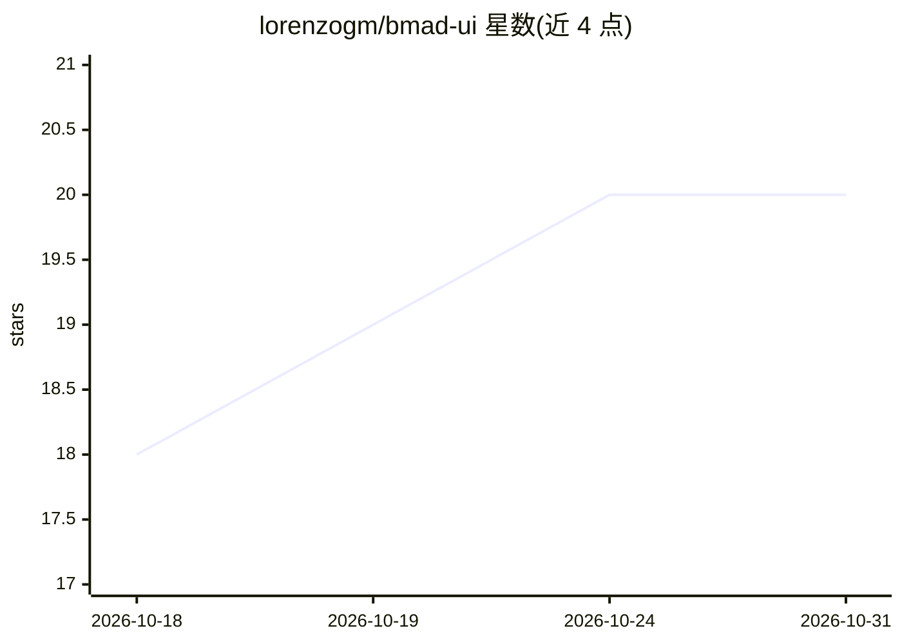

# lorenzogm/bmad-ui

⭐ 20 · TypeScript · MIT · 推送 2026-04-29 · [GitHub](https://github.com/lorenzogm/bmad-ui) · 个人维护

**BMAD 多智能体开发工作流的可视化 Web 界面**

基于 React 19 + TypeScript + Vite 构建的 Web 应用，为 BMAD（Build Manage Analyze Deploy）多智能体系统提供可视化界面：实时监控智能体工作流与任务执行、Sprint 进度与 story/epic 分析、agent 会话分析。本地运行只需 Node.js 18+ 与 pnpm，无需密钥或环境变量；维护者部署到 Vercel 需配置仓库 secrets。含 lint/类型/测试/构建一体的质量检查命令，MIT 许可。

## 筛选速览

| 维度 | 判定 | 备注 |
|---|---|---|
| AI 角色 | `ai-ecosystem` | LLM/agent 周边工具 |
| 许可风险 | `permissive` | MIT |
| 部署形态 | `library` | 以包/库形式分发 |
| 模型依赖 | — | README 未给出锁定关系 |
| 硬件要求 | — | 无带数字的原话,不猜 |
| 安装摩擦 | `low` | 无编译、无系统依赖或容器化 |
| 成熟度 | — | 结构信号不足 |

## 能力要点

- 实时追踪智能体工作流与任务执行
- Sprint 进度可视化与 story/epic 分析
- agent 会话综合分析
- 本地运行无需密钥或环境变量

## 适用场景

- 可视化监控 BMAD 多智能体系统的工作流
- 跟踪敏捷开发的 Sprint 与 epic 进度
- 分析 agent 会话与交互数据

## 场景标签

`多智能体` · 领域:Agent 开发

## 证据(README 行号)

> L3: Visual companion for BMAD agentic development workflows.
> L7: BMAD UI is a React-based web application that provides real-time visibility into AI agent orchestration, sprint prog

## 星数曲线

2026-10-18 18 → 2026-10-31 20（+2）

---
*卡片 v1 · prompt 1.4 · 生成 2026-10-28 · 置信度 mid · 依据 README sha `11774d5ec2a6` · [字段定义](../../DATASET.md)*
