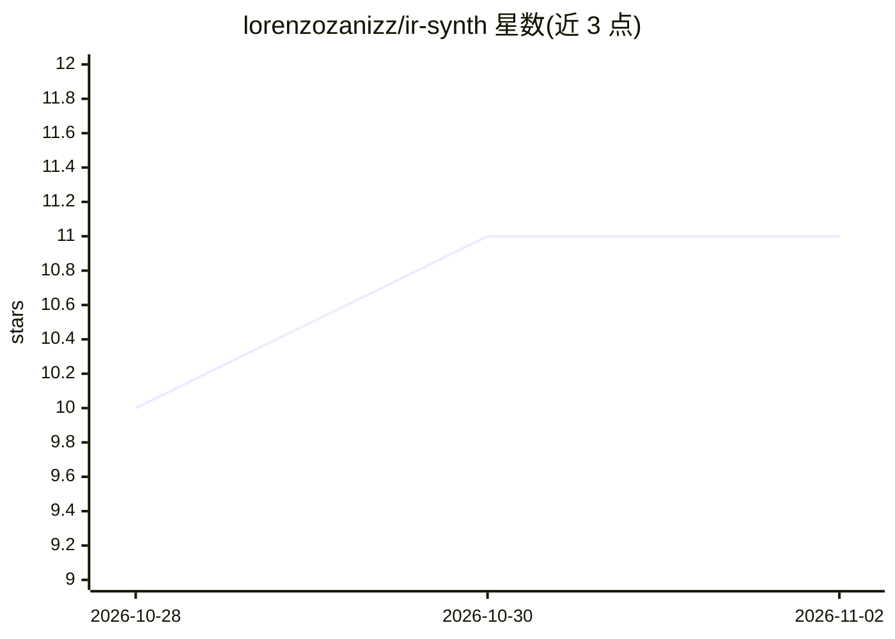

# lorenzozanizz/ir-synth

⭐ 11 · Python · MIT · 推送 2026-10-30 · [GitHub](https://github.com/lorenzozanizz/ir-synth) · [官网](https://lorenzozanizz.github.io/ir-synth/) · 个人维护

**Blender 插件：程序化生成带标注的合成热成像数据**

Blender 插件，在 3D 场景上叠加温度场模拟，将温度转换为辐射并渲染成模拟红外传感器采集的热成像图像，用于训练和测试热成像计算机视觉模型，替代真实热像仪与物理场景。流程为：设定初始温度场（手工或脚本/外部数据驱动）、可选设置材质发射率与环境温湿度、选择辐射发射模型（在物理精度与速度间取舍）、渲染输出热图像。提供外部框架调用的标准 hooks，可从无头 Blender 场景创建并渲染热学配置；文档仍在建设中，渲染系统开发进行中，BlenderProc/RenderSynth 集成为计划方向。

## 筛选速览

| 维度 | 判定 | 备注 |
|---|---|---|
| AI 角色 | `ai-ecosystem` | LLM/agent 周边工具 |
| 许可风险 | `permissive` | MIT |
| 部署形态 | `None` |  |
| 模型依赖 | — | README 未给出锁定关系 |
| 硬件要求 | — | 无带数字的原话,不猜 |
| 安装摩擦 | `low` | 无编译、无系统依赖或容器化 |
| 成熟度 | `idea` | |

## 能力要点

- 温度场→辐射→热成像渲染的四步流程
- 多种辐射发射模型可选，权衡物理精度与速度
- 标准 hooks 支持从无头 Blender 场景自动化生成热学配置
- 支持材质发射率、环境温湿度等环境参数设置

## 适用场景

- 无热像仪的情况下批量生成带标注的红外训练数据
- 为热成像目标检测模型构造可控的合成数据集
- 脚本化/headless 批量生成热成像渲染结果

## 场景标签

 · 领域:计算机视觉/合成数据生成

## 证据(README 行号)

> L7: IR-synth is a Blender add-on for generating synthetic thermal imagery. The goal is to make it easy to produce realis
> L27: The project is meant to plug into a broader synthetic data ecosystem. There's an intention to integrate with Blende

## 星数曲线

2026-10-28 10 → 2026-11-02 11（+1）

---
*卡片 v1 · prompt 1.4 · 生成 2026-11-02 · 置信度 mid · 依据 README sha `5ffdef5ffd35` · [字段定义](../../DATASET.md)*
