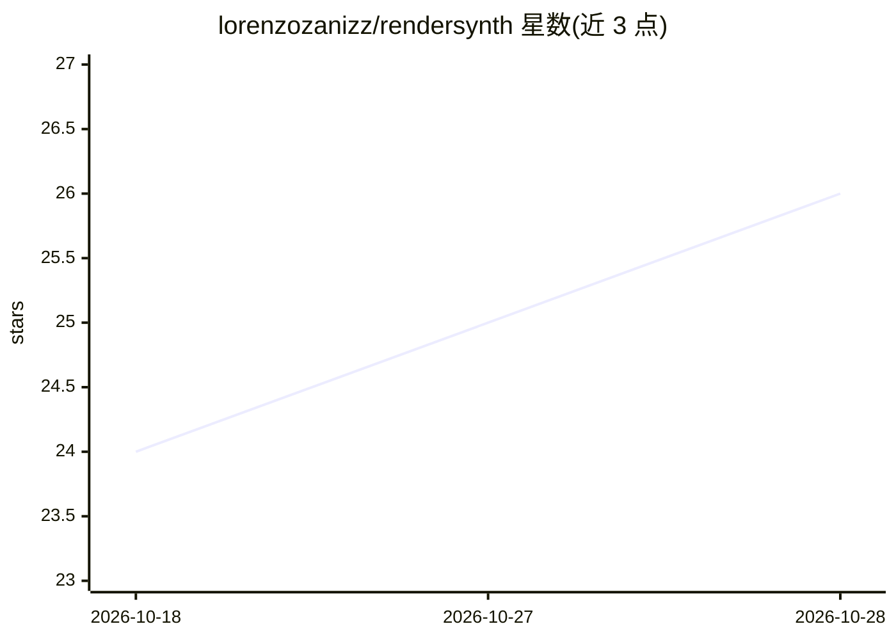

# lorenzozanizz/rendersynth

⭐ 27 · Python · MIT · 推送 2026-10-26 · [GitHub](https://github.com/lorenzozanizz/rendersynth) · [官网](https://lorenzozanizz.github.io/rendersynth/) · 个人维护

**Blender 扩展：无代码生成计算机视觉合成图像数据集**

Blender 4.5+ 扩展，通过程序化随机化与批量渲染生成带标注的合成图像数据集：以积木式管线定义对象变换、材质属性、光照、相机等参数的随机分布，支持指定种子以保证可复现，配置以 JSON 存取。标注格式覆盖 YOLO、COCO、COCO Keypoints、语义分割、深度图、法线图、CVAT XML 与点云，并可在 Blender 内预览边界框与标签。面向中低规模计算机视觉项目。多个功能（节点编辑器、约束求解、日志系统）标注为开发中。

## 筛选速览

| 维度 | 判定 | 备注 |
|---|---|---|
| AI 角色 | `ai-ecosystem` | LLM/agent 周边工具 |
| 许可风险 | `permissive` | MIT |
| 部署形态 | `desktop` | 安装包/桌面程序 |
| 模型依赖 | — | README 未给出锁定关系 |
| 硬件要求 | — | 无带数字的原话,不猜 |
| 安装摩擦 | `low` | 无编译、无系统依赖或容器化 |
| 成熟度 | — | 结构信号不足 |

## 能力要点

- 分布驱动的多参数随机化管线（变换/材质/光照/相机/约束）
- 8 类标注导出格式（YOLO、COCO、分割、深度图、点云等）
- 管线配置 JSON 存取，种子可复现
- Blender 内实时预览边界框、标签与可见性统计

## 适用场景

- 为计算机视觉模型训练生成带标注的合成数据集
- 通过可控随机化扩充多样化训练场景
- 复现和版本化管理数据集生成实验

## 场景标签

 · 领域:计算机视觉/合成数据

## 证据(README 行号)

> L9: A Blender extension for generating synthetic datasets through procedural randomization and batch rendering. This add
> L33: - **Export Integration**: Export rendered datasets in formats compatible with computer vision frameworks (YOLO, COC

## 星数曲线

2026-10-18 24 → 2026-10-28 26（+2）

---
*卡片 v1 · prompt 1.4 · 生成 2026-10-27 · 置信度 high · 依据 README sha `4cb85a909a7c` · [字段定义](../../DATASET.md)*
