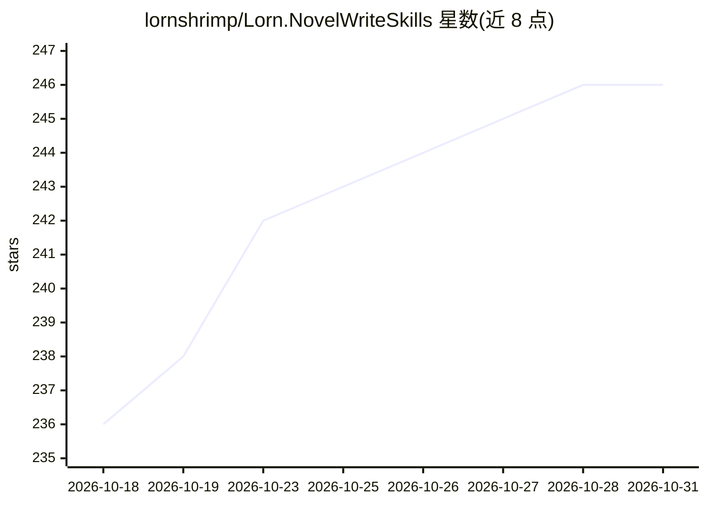

# lornshrimp/Lorn.NovelWriteSkills

⭐ 246 · PowerShell · 推送 2026-09-04 · [GitHub](https://github.com/lornshrimp/Lorn.NovelWriteSkills) · 个人维护 · 中文 README

**长篇网文/小说创作的 AI 写作资产库：Skill+Prompt+脚本**

以 Markdown 组织的可复用写作系统，围绕题材设计→大纲→章节创作→审阅润色→多平台改写→质量门禁→分发落盘的流程搭建。分层包含通用 Skill 能力本体、题材包装层 Skill、执行型 Prompt/SOP、局部 Instructions 与写作期维护脚本；内置 8 个题材目录（都市悬疑、AI科幻、女频爱情等）与 13 个平台定制输出方向，含文风蒸馏、章节闭环、相似度与反注水门禁。主要面向 VS Code / GitHub Copilot 自定义工作流用户。

## 筛选速览

| 维度 | 判定 | 备注 |
|---|---|---|
| AI 角色 | `ai-knowledge` | 知识聚合/清单类 |
| 许可风险 | `none` | — |
| 部署形态 | `None` |  |
| 模型依赖 | — | README 未给出锁定关系 |
| 硬件要求 | — | 无带数字的原话,不猜 |
| 安装摩擦 | `low` | 无编译、无系统依赖或容器化 |
| 成熟度 | — | 结构信号不足 |

## 能力要点

- 文风/作品蓝本/写作研究三类蒸馏模板，注册到 Agents.md 供下游 Skill 消费
- 8 个题材目录与 13 个平台定制输出版本（番茄、七猫、知乎、WebNovel 等）
- scripts/ 提供质检、相似度、格式化与平台门禁脚本
- 15 个平台分发 Skill，支持并行分发、断点恢复、章节唯一键追踪

## 适用场景

- 用 AI 按完整流程写长篇网文并做多平台差异化输出
- 把零散提示词整理成长期可维护的写作资产
- 为不同平台生成定制版本并通过质量门禁后分发

## 场景标签

`AI 写作` `提示工程` · 领域:Agent 开发

## 证据(README 行号)

> L3: 一个面向**长篇网文 / 小说创作工作流**的 AI 写作资产库。它不是“随手堆提示词”的仓库，而是一套围绕 **题材设计 → 大纲搭建 → 章节创作 → 审阅润色 → 多平台改写 → 质量门禁 → 分发落盘** 搭起来的可复用写作
> L30:  - `CommonSkills/`：沉淀跨题材复用的能力本体
> L196: 这个仓库采用了 `.github/prompts/`、`.github/skills/`、`.github/instructions/` 这样的结构，非常适合在 VS Code 的 GitHub Copilot 自定义工作流中使

## 星数曲线

2026-10-18 236 → 2026-10-31 246（+10）

---
*卡片 v1 · prompt 1.4 · 生成 2026-10-22 · 置信度 high · 依据 README sha `d0c26a31204a` · [字段定义](../../DATASET.md)*
