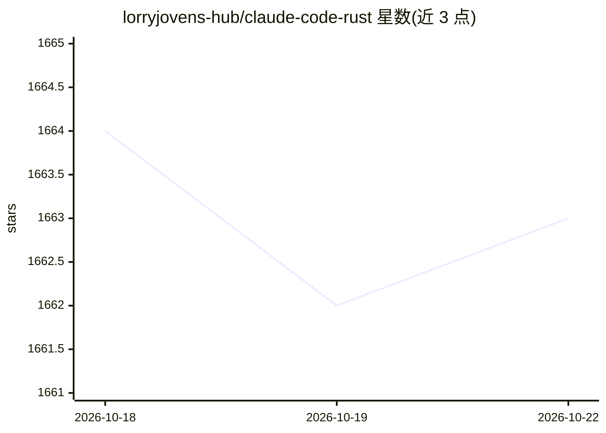

# lorryjovens-hub/claude-code-rust

⭐ 1,663 · TypeScript · 推送 2026-05-30 · [GitHub](https://github.com/lorryjovens-hub/claude-code-rust) · 个人维护

**Tauri 2.0 构建的 AI 聊天桌面客户端**

基于 Tauri 2.0 + Rust 后端与 React 19 前端的桌面聊天应用，封装 Claude 及 OpenAI、DeepSeek 等兼容 API，支持流式多模型对话、SQLite 历史持久化、上下文记忆、MCP 服务器集成、多 Agent 编排与技能插件系统，另带终端面板、文件浏览、知识库、研究面板、成本统计等视图。项目自述为个人/社区项目且处于活跃开发期，无官方发布安装包，需从源码构建，配置需直接编辑文件。

## 筛选速览

| 维度 | 判定 | 备注 |
|---|---|---|
| AI 角色 | `ai-native` | 本体是模型或模型工具 |
| 许可风险 | `none` | — |
| 部署形态 | `library` | 以包/库形式分发 |
| 模型依赖 | — | README 未给出锁定关系 |
| 硬件要求 | — | 无带数字的原话,不猜 |
| 安装摩擦 | `low` | 无编译、无系统依赖或容器化 |
| 成熟度 | `idea` | |

## 能力要点

- 多 Provider 流式聊天（Anthropic/OpenAI/DeepSeek 等）与 SQLite 持久化
- MCP 服务器集成、多 Agent 编排与用户可扩展技能系统
- 内置终端、代码执行、diff 查看与研究面板等辅助视图
- 可配置权限模式与逐工具权限控制

## 适用场景

- 在桌面原生窗口中与多个 LLM Provider 对话
- 通过 MCP 与技能插件扩展 AI 可调用的外部工具
- 管理带历史记录、知识库与成本统计的本地 AI 工作台

## 场景标签

`聊天机器人` · 领域:对话与助手

## 证据(README 行号)

> L3: A desktop client for AI chat assistants, built with Tauri 2.0, Rust, and React. Provides a native-feeling GUI for in
> L14: - Multi-provider chat with streaming responses (SSE)
> L22: - MCP (Model Context Protocol) server integration -- connect external tools that the AI can invoke

## 星数曲线

2026-10-18 1,664 → 2026-10-22 1,663（-1）

---
*卡片 v1 · prompt 1.4 · 生成 2026-10-21 · 置信度 high · 依据 README sha `f80698861324` · [字段定义](../../DATASET.md)*
