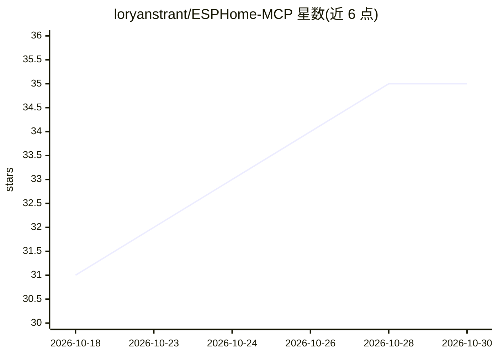

# loryanstrant/ESPHome-MCP

⭐ 35 · Python · MIT · 推送 2026-10-27 · [GitHub](https://github.com/loryanstrant/ESPHome-MCP) · 个人维护

**对接 ESPHome Device Builder 仪表盘的 MCP 服务器（17 个工具）**

为 ESPHome 2026.6+ 的 Device Builder 仪表盘提供 MCP 服务器：通过新的 WebSocket 命令协议让 Claude 等 MCP 客户端列出设备、读写与校验设备 YAML、流式读取日志、编译并 OTA 刷写固件，另有迁移旧配置、解码崩溃回溯等 5 个上游尚无对应的工具。以 Docker 容器（Streamable HTTP :8080）或 stdio 方式运行，配置走环境变量。README 声明 Device Builder 1.15+ 将自带 MCP 服务器，本项目届时可能归档。

## 筛选速览

| 维度 | 判定 | 备注 |
|---|---|---|
| AI 角色 | `ai-ecosystem` | LLM/agent 周边工具 |
| 许可风险 | `permissive` | MIT |
| 部署形态 | `self-host` | docker 或自建部署 |
| 模型依赖 | — | README 未给出锁定关系 |
| 硬件要求 | — | 无带数字的原话,不猜 |
| 安装摩擦 | `low` | 无编译、无系统依赖或容器化 |
| 成熟度 | `idea` | |

## 能力要点

- 17 个工具覆盖设备清单、YAML 读写/校验/迁移、日志流、编译与 OTA 刷写
- 针对 ESPHome 2026.6 的 WebSocket 命令协议重写传输层，兼容 1.14.x 协议
- Docker 部署，HEALTHCHECK 执行完整 MCP 握手验证仪表盘可达
- 支持 Streamable HTTP 与 stdio 两种 MCP 接入方式

## 适用场景

- 让 Claude 等 MCP 客户端直接管理 ESPHome 设备与固件
- 用对话方式编辑、校验和迁移设备 YAML 配置
- 通过 MCP 排查设备连接问题并解码崩溃回溯

## 场景标签

 · 领域:智能家居/物联网 · MCP 服务器

## 证据(README 行号)

> L3: An MCP server for the **ESPHome 2026.6+ "Device
> L4: Builder"** dashboard. It lets an MCP client (Claude, etc.) list devices, read/edit/validate
> L5: device YAML, stream logs, and compile/flash firmware — speaking the dashboard's new

## 星数曲线

2026-10-18 31 → 2026-10-30 35（+4）

---
*卡片 v1 · prompt 1.4 · 生成 2026-10-25 · 置信度 high · 依据 README sha `75f2d1c12fb2` · [字段定义](../../DATASET.md)*
