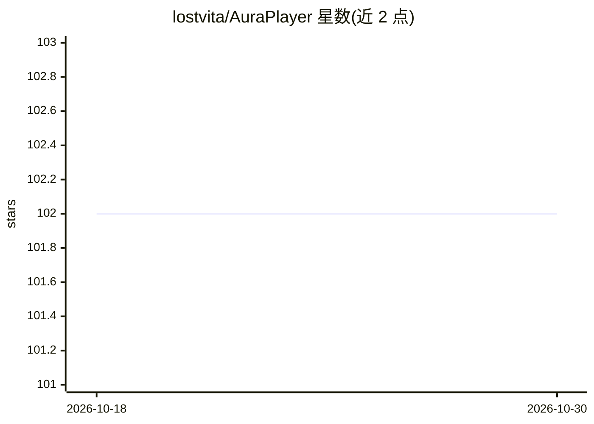

# lostvita/AuraPlayer

⭐ 102 · TypeScript · NOASSERTION · 推送 2026-08-19 · [GitHub](https://github.com/lostvita/AuraPlayer) · 个人维护 · 中文 README

**AI Agent 驱动的 B站音频播放器，支持云端搜索转 MP3**

基于 Next.js 16 / React 19 / TypeScript 的音频播放器，提供本地曲库与 B站云端双模式搜索。AI 部分：通过 @anthropic-ai/claude-agent-sdk（支持 DeepSeek / Claude API Key）实现自然语言对话搜索推荐，云端视频自动转换为本地 MP3 构建个人曲库，播放 B站来源音频时同步显示原视频弹幕，并从文件名自动解析标题、作者、日期、BV号。平台支持 macOS/Linux，Windows 需 WSL（云端转换依赖 bash 命令）。以 git clone 源码方式安装，需 Node.js >= 20 与 pnpm。

## 筛选速览

| 维度 | 判定 | 备注 |
|---|---|---|
| AI 角色 | `ai-enhanced` | 去掉 AI 部分产品仍成立 |
| 许可风险 | `none` | NOASSERTION |
| 部署形态 | `library` | 以包/库形式分发 |
| 模型依赖 | locked-api |  |
| 硬件要求 | — | 无带数字的原话,不猜 |
| 安装摩擦 | `low` | 无编译、无系统依赖或容器化 |
| 成熟度 | — | 结构信号不足 |

## 能力要点

- 自然语言对话搜索与推荐（DeepSeek / Claude）
- B站视频自动转换为本地 MP3 构建曲库
- 播放 B站来源音频时同步叠加原视频弹幕
- 智能文件名解析提取标题/作者/日期/BV号

## 适用场景

- 本地 MP3 曲库的模糊搜索播放
- 通过对话让 AI 在 B站找歌并转为音频收藏
- 听 B站音频时看原视频弹幕

## 场景标签

 · 领域:音乐播放/娱乐工具

## 证据(README 行号)

> L6: AI Agent 驱动的 B站音频播放器。随时随地，想听就听，不止于音乐。
> L15: - **AI 对话交互** — 通过自然语言告诉 AI 你想听什么，智能搜索推荐
> L28: |AI|@anthropic-ai/claude-agent-sdk（支持 DeepSeek / Claude）|

## 星数曲线

2026-10-18 102 → 2026-10-30 102（+0）

---
*卡片 v1 · prompt 1.4 · 生成 2026-10-23 · 置信度 mid · 依据 README sha `7fd515d1fb4b` · [字段定义](../../DATASET.md)*
