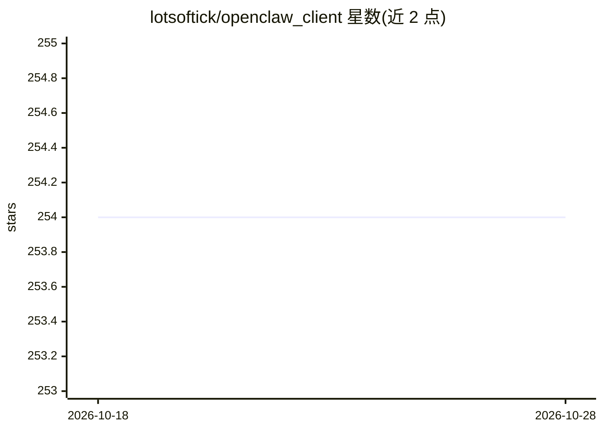

# lotsoftick/openclaw_client

⭐ 254 · TypeScript · MIT · 推送 2026-05-27 · [GitHub](https://github.com/lotsoftick/openclaw_client) · 个人维护

**面向 OpenClaw AI agent 的 Web 聊天客户端**

React 19 + Vite 前端与 Express + TypeORM + SQLite 单服务器组成的 Web 界面，用于创建和管理多个 OpenClaw agent：支持流式对话（思考过程与输出分栏显示）、文件上传到 agent 工作区、多会话管理、JWT 认证与 14 套主题，可作为 PWA 安装。前置要求 Node.js 18+ 与本机已安装认证的 OpenClaw CLI；Windows 需额外 Git 与 VS Build Tools；npm start 一键构建部署到 ~/.openclaw_client 并安装自启动与全局 CLI。默认单用户本地应用。

## 筛选速览

| 维度 | 判定 | 备注 |
|---|---|---|
| AI 角色 | `ai-ecosystem` | LLM/agent 周边工具 |
| 许可风险 | `permissive` | MIT |
| 部署形态 | `library` | 以包/库形式分发 |
| 模型依赖 | — | README 未给出锁定关系 |
| 硬件要求 | — | 无带数字的原话,不猜 |
| 安装摩擦 | `low` | 无编译、无系统依赖或容器化 |
| 成熟度 | — | 结构信号不足 |

## 能力要点

- 多 agent 创建与管理，各含独立模型与会话历史
- 流式响应，思考过程与输出分离显示
- 文件上传至 agent 工作区，JWT 认证
- 可安装为 PWA（Chromium 系完整支持，Firefox 不可安装）

## 适用场景

- 在浏览器中与多个 OpenClaw agent 对话并管理会话
- 给消息附加文件供 agent 结合工作区上下文作答
- 以桌面/移动应用形式常驻使用本地 agent 服务

## 场景标签

`聊天机器人` · 领域:对话与助手

## 证据(README 行号)

> L3: A web-based chat interface for OpenClaw AI agents. Create multiple agents, manage conversations, upload files, and s
> L18: - **API** — Express + TypeScript + TypeORM + SQLite — single server that also handles OpenClaw gateway communicatio
> L23: - OpenClaw CLI installed and authenticated on your machine

## 星数曲线

2026-10-18 254 → 2026-10-28 254（+0）

---
*卡片 v1 · prompt 1.4 · 生成 2026-10-22 · 置信度 high · 依据 README sha `f91e012edae9` · [字段定义](../../DATASET.md)*
