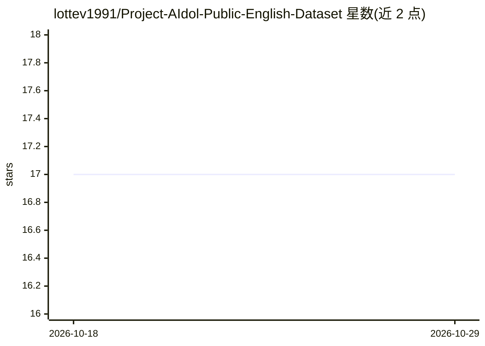

# lottev1991/Project-AIdol-Public-English-Dataset

⭐ 17 · CC-BY-SA-4.0 · 推送 2025-12-28 · [GitHub](https://github.com/lottev1991/Project-AIdol-Public-English-Dataset) · [官网](https://lottev.moe) · 个人维护

**女性英语歌声合成（SVS）公开语料库，时长1小时45分**

由个人发布的女声英语歌声数据集，用于歌声合成（SVS）训练，回应英语女声公开数据缺乏的问题。标注采用 ARPABET 音素体系并扩展 ax/dx/en 及 EP（呼气）、GS（声门塞音）、vf（气泡音）等附加音素；音源提供者非英语母音者且非职业歌手。总时长 1 小时 45 分钟。使用条款要求署名 Lotte V、禁止未经许可公开含此声音的模型、禁止用于变声器（如 RVC）及未授权人声训练，允许研究与商业用途。

## 筛选速览

| 维度 | 判定 | 备注 |
|---|---|---|
| AI 角色 | `ai-knowledge` | 知识聚合/清单类 |
| 许可风险 | `viral` | CC-BY-SA-4.0 |
| 部署形态 | `None` |  |
| 模型依赖 | — | README 未给出锁定关系 |
| 硬件要求 | — | 无带数字的原话,不猜 |
| 安装摩擦 | `low` | 无编译、无系统依赖或容器化 |
| 成熟度 | — | 结构信号不足 |

## 能力要点

- 时长 1 小时 45 分钟的女声英语歌声数据
- ARPABET 音素标注，扩展 EP/GS/vf 等附加音素
- 条款允许研究、商业用途及自用音高训练（需署名）
- 禁止用于变声器与未授权人声训练

## 适用场景

- 训练英语女声歌声合成（SVS）模型
- 为自己的歌声数据复用标注或做音高训练
- 歌声合成研究的数据补充

## 场景标签

`语音合成` · 领域:内容生成

## 证据(README 行号)

> L4: Due to a severe lack of publicly available English SVS data sung by a female singer, I have decided to publish my ow
> L9: This dataset uses ARPABET phonemes, including the extended phonemes `ax` (schwa), `dx` (tap) and `en` (syllabic `n`)

## 星数曲线

2026-10-18 17 → 2026-10-29 17（+0）

---
*卡片 v1 · prompt 1.4 · 生成 2026-10-29 · 置信度 high · 依据 README sha `84f953e95a2b` · [字段定义](../../DATASET.md)*
