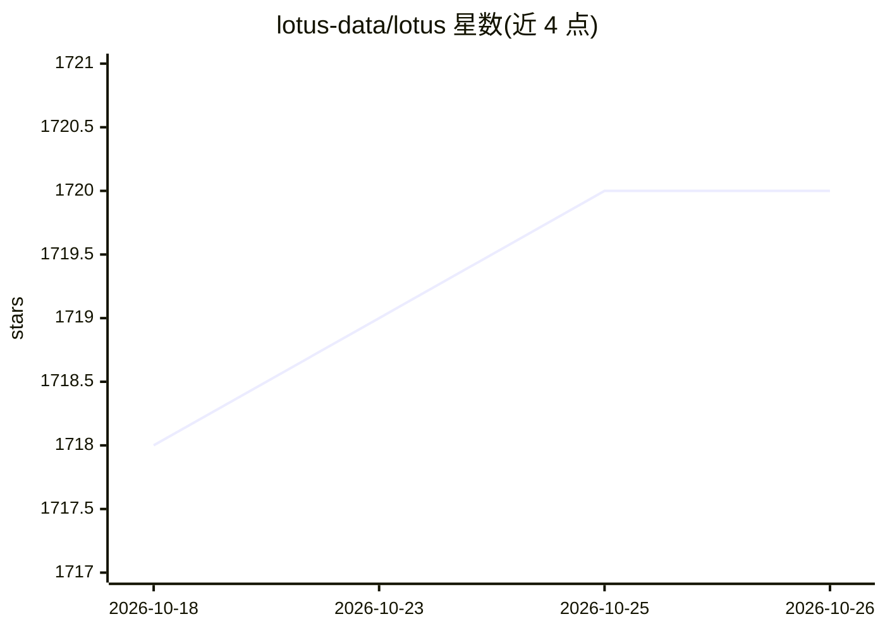

# lotus-data/lotus

⭐ 1,720 · Python · Apache-2.0 · 推送 2026-10-08 · [GitHub](https://github.com/lotus-data/lotus) · [官网](https://lotus-data.github.io) · 组织维护

**用 LLM 与 agent 批量处理数据集的语义算子库**

LOTUS 是一个 Python 库（pip 安装 lotus-ai），提供基于 LLM 的语义算子（sem_map/sem_filter/sem_agg/sem_join 等）与 agentic 算子（每分片并行运行带沙箱 Python REPL 的工具型 agent），让开发者以自然语言指令对大规模结构化与非结构化数据做 map/reduce/filter/join 处理。其优化器负责批处理调用、模型级联与惰性管线规划，以降低成本。模型接入通过 LiteLLM 支持任意 provider。项目来自 Stanford 与 UC Berkeley，附有 arXiv 论文。

## 筛选速览

| 维度 | 判定 | 备注 |
|---|---|---|
| AI 角色 | `ai-ecosystem` | LLM/agent 周边工具 |
| 许可风险 | `permissive` | Apache-2.0 |
| 部署形态 | `library` | 以包/库形式分发 |
| 模型依赖 | — | README 未给出锁定关系 |
| 硬件要求 | — | 无带数字的原话,不猜 |
| 安装摩擦 | `low` | 无编译、无系统依赖或容器化 |
| 成熟度 | — | 结构信号不足 |

## 能力要点

- LLM 语义算子：sem_map/sem_filter/sem_agg/sem_join/sem_extract 等
- Agentic 算子：按分片并行运行带沙箱 Python REPL 的工具型 agent
- 优化器做批处理、模型级联与惰性管线规划
- 模型接入支持任意 LiteLLM provider（含检索器与重排器）

## 适用场景

- 对代码库或文档集做大规模 agent 分析与汇总
- 逐行用 LLM-judge 评估模型输出或内容质量
- 从非结构化文档批量抽取结构化字段

## 场景标签

`数据分析` · 领域:效率与自动化

## 证据(README 行号)

> L20: LOTUS makes **agentic and LLM bulk processing** fast, easy, and robust. It introduces and optimizes
> L21: **semantic operators** (e.g., LLM-based `map`,
> L108: - Supported Models — LMs, retrievers, rerankers (any LiteLLM provider)

## 星数曲线

2026-10-18 1,718 → 2026-10-26 1,720（+2）

---
*卡片 v1 · prompt 1.4 · 生成 2026-10-21 · 置信度 high · 依据 README sha `c60c70d057e0` · [字段定义](../../DATASET.md)*
