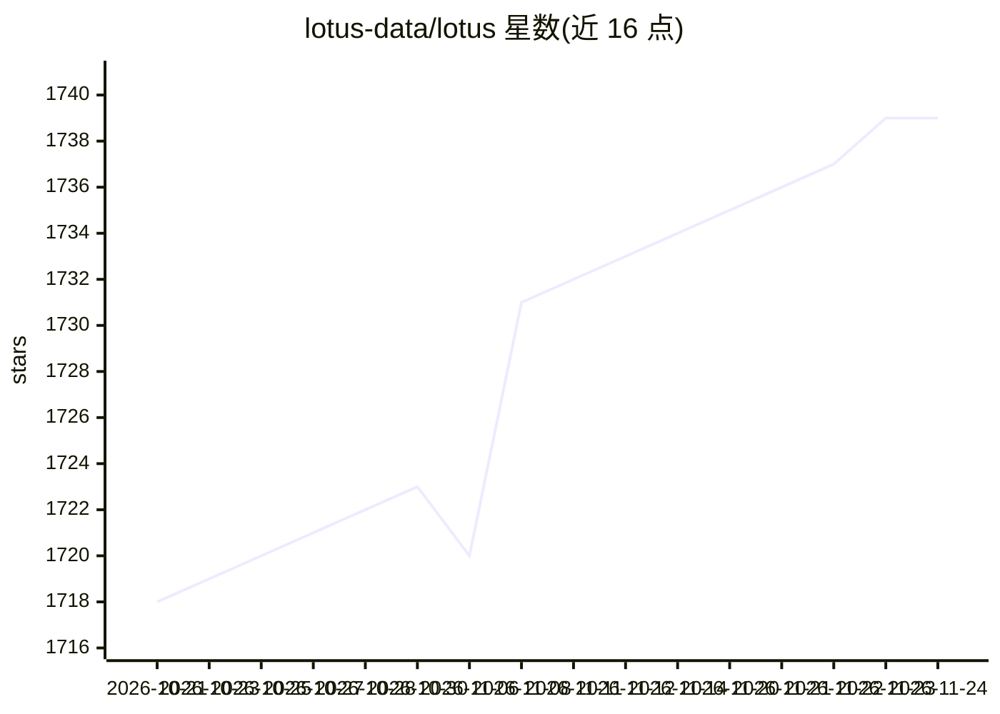

# lotus-data/lotus

⭐ 1,739 · Python · Apache-2.0 · 推送 2026-11-10 · [GitHub](https://github.com/lotus-data/lotus) · [官网](https://lotus-data.github.io) · 组织维护

**面向开发者的数据集 LLM 批处理框架：语义算子+优化器**

来自 Stanford 与 UC Berkeley 的 Python 库，用 LLM 语义算子（sem_map/sem_filter/sem_agg/sem_join/sem_extract）对大规模文本与非结构化数据做批处理；另提供 agentic 算子，为每个数据分片并行生成带沙箱 Python REPL 的工具型 agent，再归约为单一答案。其优化器通过批调用、模型级联与惰性执行规划流水线。依赖 LiteLLM 接入模型，需设置 API key。有论文与 Colab 示例。

## 筛选速览

| 维度 | 判定 | 备注 |
|---|---|---|
| AI 角色 | `ai-ecosystem` | LLM/agent 周边工具 |
| 许可风险 | `permissive` | Apache-2.0 |
| 部署形态 | `library` | 以包/库形式分发 |
| 模型依赖 | — | README 未给出锁定关系 |
| 硬件要求 | — | 无带数字的原话,不猜 |
| 安装摩擦 | `low` | 无编译、无系统依赖或容器化 |
| 成熟度 | — | 结构信号不足 |

## 能力要点

- 两类语义算子：LLM 算子（sem_map/filter/agg/join/extract）与 agentic 算子（corpus.agent）
- 优化器执行批调用、模型级联、代理与惰性流水线规划
- 每个分片并行运行带沙箱 Python REPL 的 agent，支持精确计算
- 模型接入经 LiteLLM，支持任意 LiteLLM provider

## 适用场景

- 对代码库、文档或记录逐条运行 agent 做分析与迁移
- 在语料上扇出提取并合成研究结论
- 逐行打分评估模型输出与内容质量（LLM-as-judge）
- 对非结构化文本抽取结构化字段并做 RAG 问答

## 场景标签

`数据分析` `文档解析` · 领域:效率与自动化

## 证据(README 行号)

> L20: LOTUS makes **agentic and LLM bulk processing** fast, easy, and robust. It introduces and optimizes
> L67: You express *what* you want over a dataset using high-level **semantic operators** (i.e., LLM-based map, reduce, fi
> L89: LOTUS supports **two classes of semantic operators**, so you can match the execution style to the task:

## 星数曲线

2026-10-21 1,718 → 2026-11-24 1,739（+21）

---
*卡片 v1 · prompt 1.4 · 生成 2026-11-23 · 置信度 high · 依据 README sha `d2dfa630472f` · [字段定义](../../DATASET.md)*
