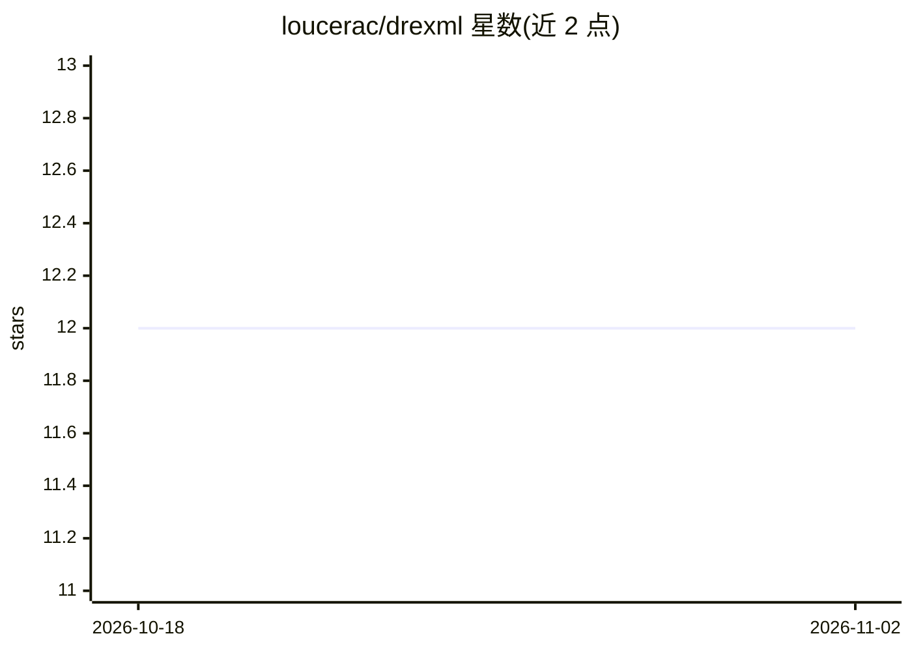

# loucerac/drexml

⭐ 12 · Python · MIT · 推送 2026-06-05 · [GitHub](https://github.com/loucerac/drexml) · [官网](https://loucerac.github.io/drexml/) · 个人维护

**药物重定位的命令行与 Python 工具：可解释机器学习+信号通路模型**

drexml 是用于药物重定位（drug repurposing）的 Python 包与命令行工具，结合可解释机器学习与信号转导机理模型。用户通过环境文件定义疾病（种子基因、DisGeNET 疾病 ID 或自定义 KEGG/Hipathia 电路列表），运行 drexml run 指定 CPU/GPU 核数执行实验；首次运行会从 Zenodo 下载背景数据集。默认安装尝试编译 CUDA 模块，不可用时退回 CPU。面向计算生物学研究人员，配有发表论文与在线文档。

## 筛选速览

| 维度 | 判定 | 备注 |
|---|---|---|
| AI 角色 | `ai-native` | 本体是模型或模型工具 |
| 许可风险 | `permissive` | MIT |
| 部署形态 | `library` | 以包/库形式分发 |
| 模型依赖 | — | README 未给出锁定关系 |
| 硬件要求 | — | 无带数字的原话,不猜 |
| 安装摩擦 | `medium` | 含编译或系统依赖之一 |
| 成熟度 | — | 结构信号不足 |

## 能力要点

- 通过种子基因、DisGeNET 疾病 ID 或自定义电路列表定义疾病地图
- drexml run 命令支持并行指定 CPU/GPU 设备数量
- 首次运行自动从 Zenodo 下载最新背景数据集
- 提供 CLI 与 Python 包两种使用形式

## 适用场景

- 用种子基因或 DisGeNET 关联数据做药物重定位分析
- 基于 KEGG/Hipathia 信号通路电路建模疾病并筛选候选药物
- 科研环境下复现发表论文中的重定位实验

## 场景标签

`科研工具` · 领域:学习与行业

## 证据(README 行号)

> L8: Repository for the `drexml` python package: (DRExM³L) Drug REpurposing using eXplainable Machine Learning and Mechan
> L14: Esteban-Medina M, de la Oliva Roque VM, Herráiz-Gil S, Peña-Chilet M, Dopazo J, Loucera C. drexml: A command line t

## 星数曲线

2026-10-18 12 → 2026-11-02 12（+0）

---
*卡片 v1 · prompt 1.4 · 生成 2026-11-01 · 置信度 high · 依据 README sha `718c1f29e3b3` · [字段定义](../../DATASET.md)*
