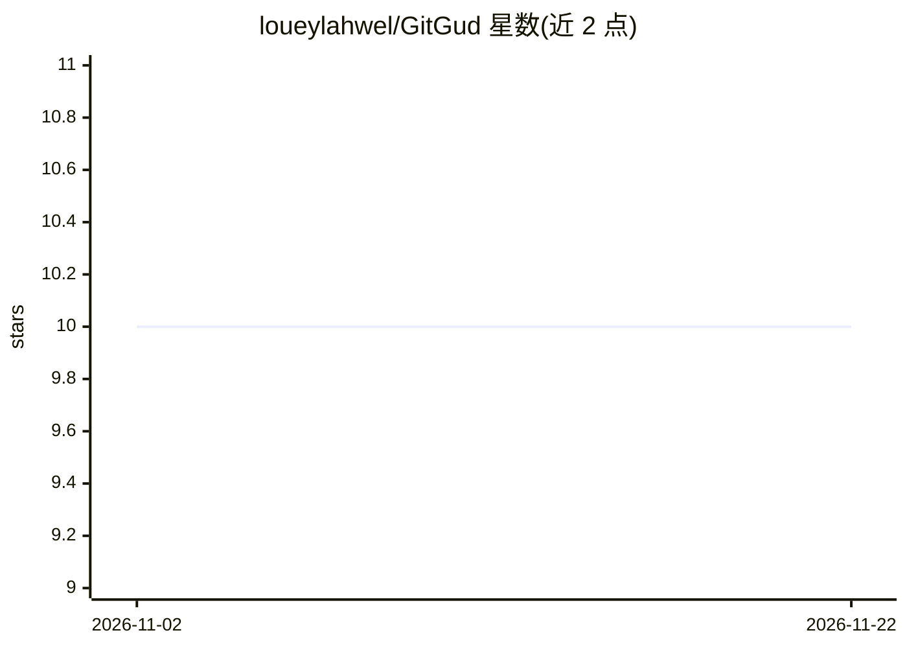

# loueylahwel/GitGud

⭐ 10 · Python · 推送 2026-08-07 · [GitHub](https://github.com/loueylahwel/GitGud) · 个人维护

**把 GitHub 仓库转为简历条目并自动插入 LaTeX 简历**

全栈应用：用户通过 GitHub OAuth 登录后，系统按三层流水线分析其仓库——规则质量过滤、基于 Groq 的领域判定与职业画像评分、基于 Groq 的简历条目建议生成。用户上传 .tex 简历源文件并解析职业画像，选定建议后由 LLM 将项目条目写入 LaTeX 源码并编译为 PDF。后端 FastAPI + PostgreSQL + Celery/Redis + MinIO，前端 React/Vite，Docker Compose 一键编排全部服务，GitHub webhook 保持仓库数据同步。

## 筛选速览

| 维度 | 判定 | 备注 |
|---|---|---|
| AI 角色 | `ai-native` | 本体是模型或模型工具 |
| 许可风险 | `none` | — |
| 部署形态 | `self-host` | docker 或自建部署 |
| 模型依赖 | locked-api |  |
| 硬件要求 | — | 无带数字的原话,不猜 |
| 安装摩擦 | `low` | 无编译、无系统依赖或容器化 |
| 成熟度 | — | 结构信号不足 |

## 能力要点

- 三层仓库分析流水线：规则过滤 + Groq 领域评分 + 建议生成
- LLM 编辑 LaTeX 源文件并编译为 PDF
- GitHub OAuth 与 webhook 自动同步重分析
- Docker Compose 编排 7 个服务，含自动迁移

## 适用场景

- 把我的 GitHub 项目自动整理成简历条目
- 无需手写 LaTeX 就能把项目插入简历并导出 PDF
- 按职业画像筛选值得写进简历的仓库

## 场景标签

`AI 写作` · 领域:内容生成

## 证据(README 行号)

> L5: GitGud is a full-stack application that generates resume-worthy CV entries from a user's GitHub repositories and ins
> L16:  2. Groq-based domain detection and scoring against the user's career profile.

## 星数曲线

2026-11-02 10 → 2026-11-22 10（+0）

---
*卡片 v1 · prompt 1.4 · 生成 2026-11-19 · 置信度 mid · 依据 README sha `a5fbc98bdb05` · [字段定义](../../DATASET.md)*
