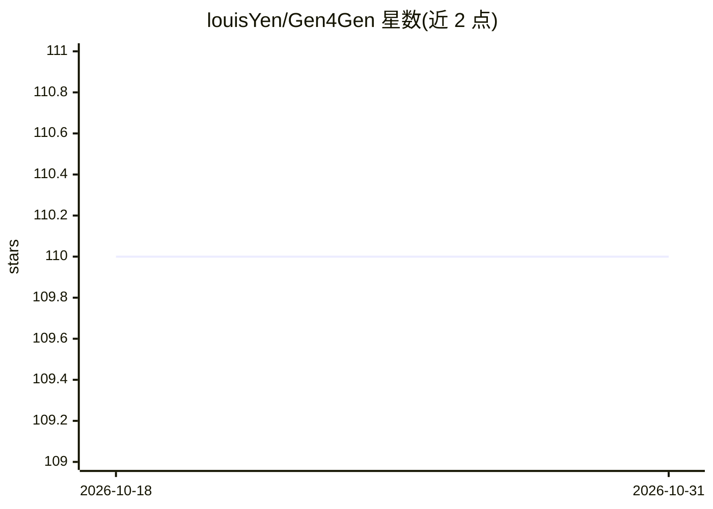

# louisYen/Gen4Gen

⭐ 110 · Python · MIT · 推送 2026-03-27 · [GitHub](https://github.com/louisYen/Gen4Gen) · [官网](https://danielchyeh.github.io/Gen4Gen/) · 组织维护

**面向多概念合成的生成式数据管线官方实现（BMVC 2025）**

论文 "Gen4Gen: Generative Data Pipeline for Generative Multi-Concept Composition"（BMVC 2025）的官方实现。提供将个人概念（用户提供的目标图像）合成到具有复杂构图的真实场景中并生成详细文本描述的数据集创建管线工具集，配套 MyCanvas 数据集。流程使用 OpenAI API 做 LLM 引导的物体组合，基于 DIS、LLM-grounded Diffusion、SD-XL Inpainting 与 custom-diffusion 构建。运行需要 PyTorch 1.13.1、CUDA 11.7、diffusers 0.21.4，GPU 要求 A100-40GB 或 RTX 4090-24GB（背景重绘步骤约需 17GB 显存）。

## 筛选速览

| 维度 | 判定 | 备注 |
|---|---|---|
| AI 角色 | `ai-native` | 本体是模型或模型工具 |
| 许可风险 | `permissive` | MIT |
| 部署形态 | `None` |  |
| 模型依赖 | — | README 未给出锁定关系 |
| 硬件要求 | — | 无带数字的原话,不猜 |
| 安装摩擦 | `medium` | 含编译或系统依赖之一 |
| 成熟度 | — | 结构信号不足 |

## 能力要点

- 将个人概念合成到复杂构图真实场景并生成详细文本描述的数据管线
- 使用 OpenAI API 进行 LLM 引导的物体组合
- 基于 DIS、LLM-grounded Diffusion、SD-XL Inpainting、custom-diffusion 构建
- 配套 MyCanvas 数据集

## 适用场景

- 为个性化文生图研究构造多概念合成训练数据
- 复现 Gen4Gen/MyCanvas 相关实验
- 将自己的图像素材接入管线生成带描述的合成场景

## 场景标签

`图像生成` · 领域:内容生成

## 证据(README 行号)

> L11: **TL;DR**: We introduce a dataset creation pipeline, **Gen4Gen**, to compose personal concept into realistic scenes
> L21: - **gen4gen**: Toolkits for Gen4Gen pipeline.

## 星数曲线

2026-10-18 110 → 2026-10-31 110（+0）

---
*卡片 v1 · prompt 1.4 · 生成 2026-10-23 · 置信度 high · 依据 README sha `9a6875d2656e` · [字段定义](../../DATASET.md)*
