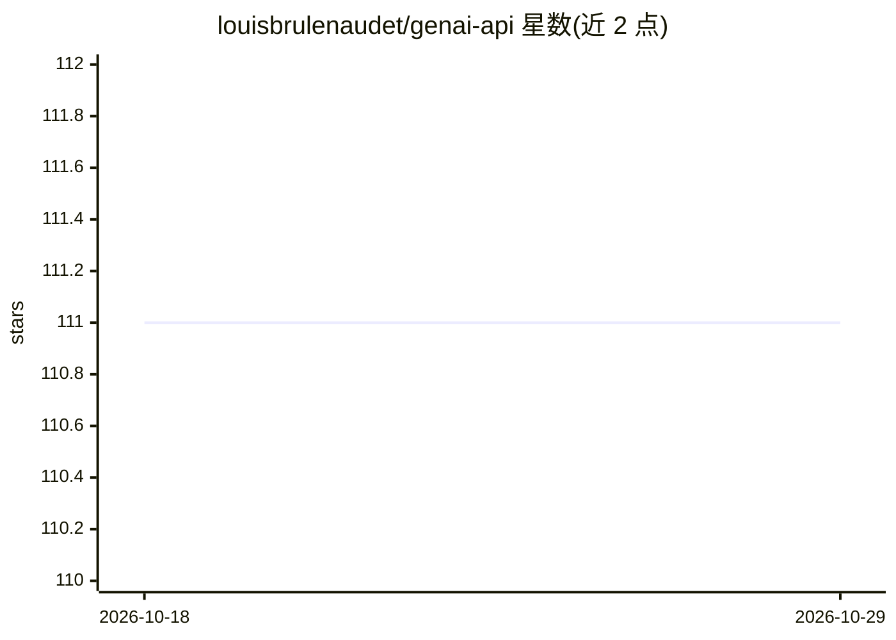

# louisbrulenaudet/genai-api

⭐ 111 · TypeScript · Apache-2.0 · 推送 2026-04-05 · [GitHub](https://github.com/louisbrulenaudet/genai-api) · [官网](https://producthunt.com/products/genai-api-for-apple-shortcuts) · 个人维护

**部署到 Cloudflare Workers 的 Gemini API 网关，供 Apple 快捷指令等调用**

用 TypeScript（Hono 框架）编写、部署为 Cloudflare Worker 的生成式 AI API：接收 OpenAI 风格的 messages 请求（支持文本与 data URL 图片的多模态输入），转发至 Google AI Studio 的 Gemini 系列模型并返回纯文本补全。最初面向 Apple 快捷指令场景设计，现可用于任何应用。部署流程为下载仓库、配置 wrangler.jsonc、以 wrangler secret 存入 API key 与 Bearer token 后 make deploy；本地开发经 make dev 运行于 8788 端口。认证要求 Authorization Bearer 头，可选 X-API-Key 传递按请求的专属密钥。

## 筛选速览

| 维度 | 判定 | 备注 |
|---|---|---|
| AI 角色 | `ai-ecosystem` | LLM/agent 周边工具 |
| 许可风险 | `permissive` | Apache-2.0 |
| 部署形态 | `None` |  |
| 模型依赖 | — | README 未给出锁定关系 |
| 硬件要求 | — | 无带数字的原话,不猜 |
| 安装摩擦 | `low` | 无编译、无系统依赖或容器化 |
| 成熟度 | — | 结构信号不足 |

## 能力要点

- OpenAI 风格 messages 格式的 /completion 端点，支持文本与图片多模态输入
- 接入 Google AI Studio 的 gemini-2.5-flash 等四个模型
- 通过 wrangler secret 管理 API key 与 Bearer token 认证
- 本地开发服务器运行于 8788 端口

## 适用场景

- 给 Apple 快捷指令加上生成式 AI 调用能力
- 以低成本把 Gemini 能力封装为自部署 API 供任意应用调用
- 在自有 Cloudflare 账号下统一管控 AI 请求的认证

## 场景标签

`模型网关` · 领域:Agent 开发

## 证据(README 行号)

> L10: This TypeScript API built with Hono, OpenAI, and deployed as a Cloudflare Worker aims originally to boost the perfo
> L38: - **Providers:** `google-ai-studio`

## 星数曲线

2026-10-18 111 → 2026-10-29 111（+0）

---
*卡片 v1 · prompt 1.4 · 生成 2026-10-23 · 置信度 high · 依据 README sha `cae1a21539b5` · [字段定义](../../DATASET.md)*
