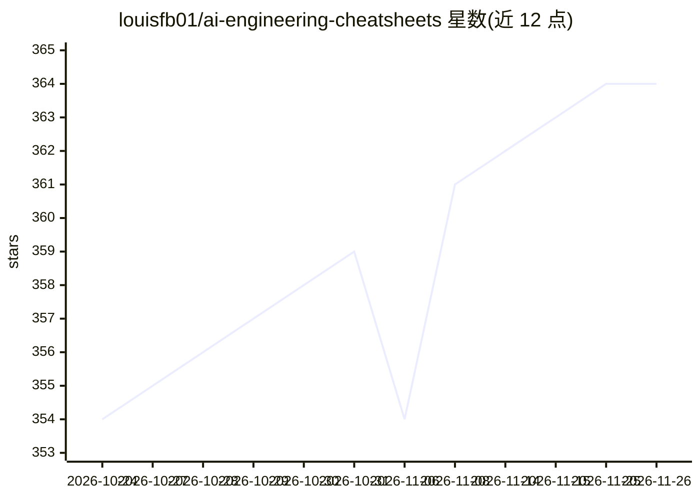

# louisfb01/ai-engineering-cheatsheets

⭐ 364 · 推送 2026-10-21 · [GitHub](https://github.com/louisfb01/ai-engineering-cheatsheets) · [官网](https://academy.towardsai.net/?ref=1f9b29) · 个人维护

**AI 工程师速查表集：按决策表查找常见问题的推荐做法**

由 Towards AI 课程衍生的三份速查表：AI Engineering Playbook 覆盖技术/模型/RAG/评测等选型决策表；Agent 架构与运维指南给出工作流、单 Agent、多 Agent 的取舍及运维机制；Anti-Slop 写作指南基于 6,750 份评审草稿总结 AI 写作特征与改写规则。使用方式为查表定位情境后按推荐执行；模型与工具偏好标注快照时间，需自行验证。内容与 Towards AI 付费课程及新书相关联。

## 筛选速览

| 维度 | 判定 | 备注 |
|---|---|---|
| AI 角色 | `ai-knowledge` | 知识聚合/清单类 |
| 许可风险 | `none` | — |
| 部署形态 | `None` |  |
| 模型依赖 | — | README 未给出锁定关系 |
| 硬件要求 | — | 无带数字的原话,不猜 |
| 安装摩擦 | `low` | 无编译、无系统依赖或容器化 |
| 成熟度 | — | 结构信号不足 |

## 能力要点

- 三份速查表以决策表形式组织，按情境给出推荐做法
- Agent 指南覆盖工作流/单 Agent/多 Agent 取舍及运维机制
- Anti-Slop 指南基于 6,750 份评审草稿给出写作规则
- 模型与工具偏好附快照时间（2026 年 8 月/10 月）

## 适用场景

- 选型 RAG/评测/记忆模式时查决策表找起点
- 决定该用工作流还是单/多 Agent 架构
- 改进 AI 生成文案，去除 AI 写作特征

## 场景标签

`教程课程` · 领域:学习与行业

## 证据(README 行号)

> L5: Goal: give you decision-ready references for the most common AI engineering problems. Open a cheatsheet, find your s
> L11: ## Cheatsheets
> L29: These cheatsheets come from the Towards AI courses. They cover the same frameworks in more depth, with full lessons

## 星数曲线

2026-10-24 354 → 2026-11-26 364（+10）

---
*卡片 v1 · prompt 1.4 · 生成 2026-11-25 · 置信度 high · 依据 README sha `f3c33765a69c` · [字段定义](../../DATASET.md)*
