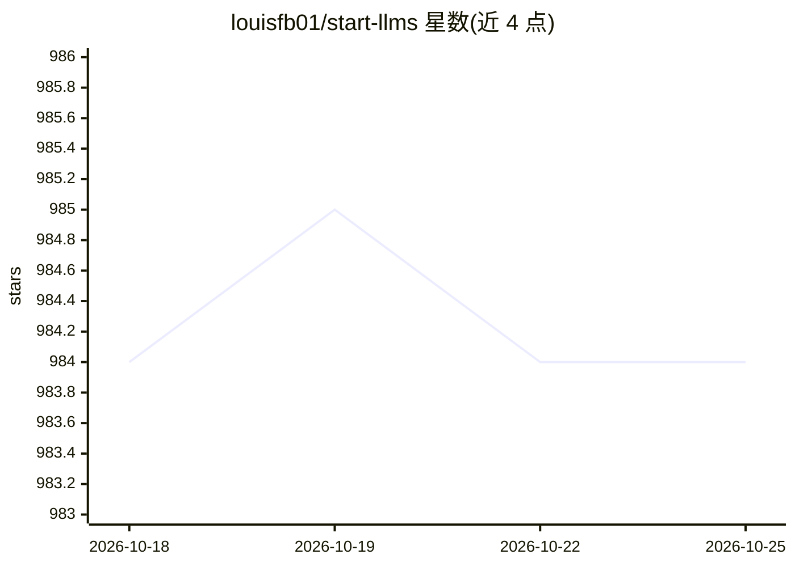

# louisfb01/start-llms

⭐ 984 · MIT · 推送 2026-01-23 · [GitHub](https://github.com/louisfb01/start-llms) · [官网](https://www.louisbouchard.ai/from-zero-to-hero-with-llms/) · 个人维护

**面向初学者的免费 LLM 学习路线资源清单**

由 louisfb01（活跃于 YouTube 与播客）维护的 LLM 学习指南：面向具备少量编程与机器学习基础的学习者，按视频入门、课程、书籍文章、实践项目、提示工程、RAG 与微调等阶段组织免费学习资源，部分付费课程含推广链接。仓库本身不含代码，仅收录链接与建议路径，读者可自选顺序与媒介。

## 筛选速览

| 维度 | 判定 | 备注 |
|---|---|---|
| AI 角色 | `ai-knowledge` | 知识聚合/清单类 |
| 许可风险 | `permissive` | MIT |
| 部署形态 | `None` |  |
| 模型依赖 | — | README 未给出锁定关系 |
| 硬件要求 | — | 无带数字的原话,不猜 |
| 安装摩擦 | `low` | 无编译、无系统依赖或容器化 |
| 成熟度 | — | 结构信号不足 |

## 能力要点

- 覆盖视频、课程、书籍、播客等多形态学习资源
- 按入门到实践的阶段性路径组织内容
- 包含提示工程与 RAG/微调专题资源

## 适用场景

- 从零基础转入 LLM 领域时寻找学习路线
- 查找免费的 LLM 课程与视频资源
- 了解 RAG、微调与提示工程方向的入门材料

## 场景标签

`精选清单` `教程课程` · 领域:学习与行业

## 证据(README 行号)

> L3: ## A complete guide to start and improve your LLM skills in 2026 without an advanced background in the field and sta
> L7: This guide is intended for anyone with a small background in programming and machine learning. There is no specific 
> L23: ## Table of Contents

## 星数曲线

2026-10-18 984 → 2026-10-25 984（+0）

---
*卡片 v1 · prompt 1.4 · 生成 2026-10-21 · 置信度 high · 依据 README sha `04f7655ce3ff` · [字段定义](../../DATASET.md)*
