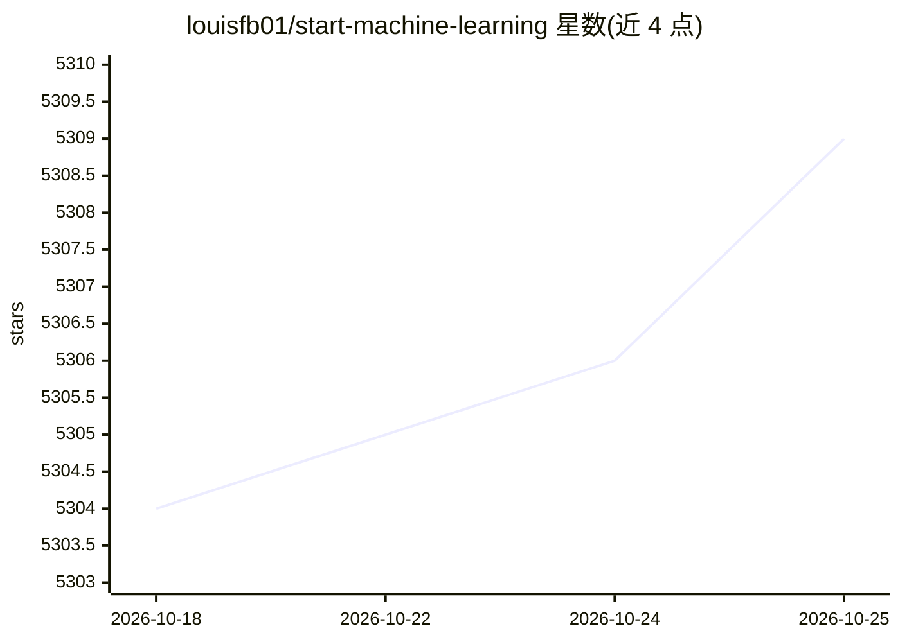

# louisfb01/start-machine-learning

⭐ 5,310 · MIT · 推送 2026-01-23 · [GitHub](https://github.com/louisfb01/start-machine-learning) · [官网](https://www.louisbouchard.ai/learnai/) · 个人维护

**面向零基础者的机器学习/AI 自学资源导航清单**

个人维护的机器学习与 AI 入门学习指南：按 YouTube 视频入门、免费课程、文章、书籍、数学基础（线性代数/统计/微积分）、Python 编程、在线课程到实践项目的路径组织资源。大部分资源免费，部分付费课程与书籍标注为可选，付费课程链接含推广联盟性质。读者可自选顺序与材料，无固定路线。维护者同时在 YouTube、播客与 newsletter 发布 AI 内容。

## 筛选速览

| 维度 | 判定 | 备注 |
|---|---|---|
| AI 角色 | `ai-knowledge` | 知识聚合/清单类 |
| 许可风险 | `permissive` | MIT |
| 部署形态 | `None` |  |
| 模型依赖 | — | README 未给出锁定关系 |
| 硬件要求 | — | 无带数字的原话,不猜 |
| 安装摩擦 | `low` | 无编译、无系统依赖或容器化 |
| 成熟度 | — | 结构信号不足 |

## 能力要点

- 覆盖视频、课程、文章、书籍、数学与编程的学习路径组织
- 大部分资源免费，付费项均标注 Optional (Paying)
- 为零编程与零数学背景读者提供分阶段入门材料
- 包含 LLM/Transformer 与模型部署方向的进阶资源

## 适用场景

- 零基础者按清单自学机器学习与 AI
- 补齐 ML 所需的数学与 Python 编程基础
- 查找免费的深度学习课程与书籍

## 场景标签

`教程课程` `精选清单` · 领域:学习与行业

## 证据(README 行号)

> L3: ## A complete guide to start and improve in machine learning (ML), artificial intelligence (AI) in 2026 without ANY 
> L5: This guide is intended for anyone having zero or a small background in programming, maths, and machine learning. The

## 星数曲线

2026-10-18 5,304 → 2026-10-25 5,309（+5）

---
*卡片 v1 · prompt 1.4 · 生成 2026-10-20 · 置信度 high · 依据 README sha `37a171a5ea7e` · [字段定义](../../DATASET.md)*
